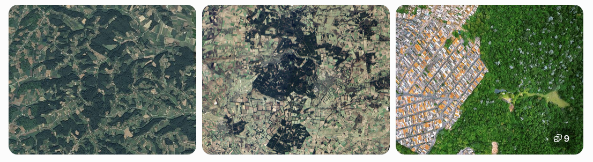
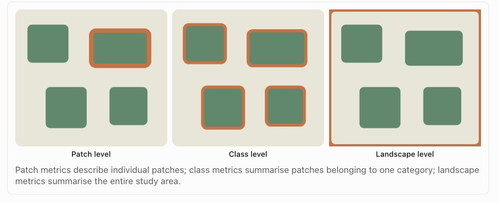
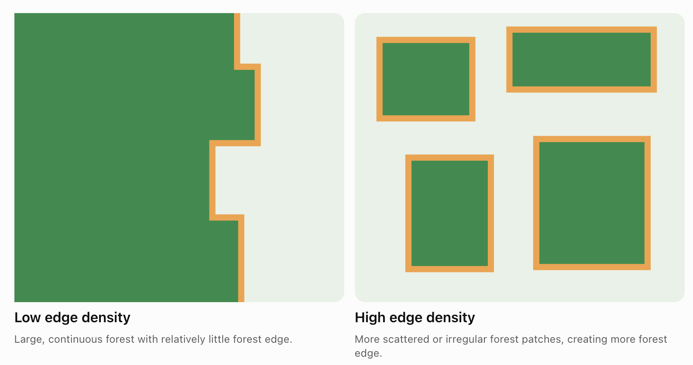

# Homework 4 {#Lab_4B .unnumbered}

### Aim {.unnumbered}

Welcome to Homework 4. Overall each lab is worth 4.8% and you can drop your lowest score. This is due the night before your next lab. The maximum time it should take is lab time plus about 2-3 hrs of your time.

<br>

### Need help?

REMEMBER THAT EVERY TIME YOU RE-OPEN R-STUDIO YOU NEED TO RE-RUN **ALL** YOUR CODE CHUNKS. The easiest way to do this is to press the "Run All" button, in the "Run" menu at the top right of your screen

<br><br>

## PART 1: Lab Setup {.unnumbered}

### STEP 1: Create your project & download data/reports {.unnumbered}

- **[1A]** If you don't already have a folder on your computer for Homework/Lab 4, make one inside your GEOG364 folder.

<br>

- **[1B]** Go to Canvas and download both the data and the lab report template. Put them in your HW4 folder and rename the lab template to include your email ID.

<br>

- **[1C]** Open R-Studio and make a project for Homework 4 in the existing HW4 folder ([Project Tutorial here](#T1_Projects))

<br>

- **[1D]** Go to the files quadrant/tab and open the RmD Lab report. If you are running your project it should be right there. If it's not, ask a teacher/TA.

<br>

- **[1E]** Optional. You are welcome and encouraged to change the YAML code or use different themes.

  - (Changing the theme to be personal to you does make grading easier! You can see them here - <https://github.com/juba/rmdformats>). *Note, unlike last week, we are using the rmdformats package which allows you to make quick professional themes, I still tend to copy/paste*.

<br>

### STEP 2: Adjust your knit options {.unnumbered}

Look at the first code chunk below the YAML code. The `knitr::opts_chunk$set(echo = TRUE)` command is from the knitr package and allows us to set general options for the entire report.

- **[2A]** Add in two more options, warning=FALSE and message=FALSE as shown below.
- knitr::opts_chunk\$set(echo = TRUE, warning=FALSE, message=FALSE)

<br>

### STEP 3: Knit and check libraries {.unnumbered}

- **[3A]** Press save and try to knit. If any packages are missing you will see

  - EITHER a little yellow bar at the top of the screen asking if you want to install the libraries. Say yes, wait until the libraries are installed and try again. <br>
  - OR an error saying that it can't find that library (it might also be a spelling mistake if you are sure it's installed). In this case, you have to go to the app store and download it (Packages/Install) - see tutorial on left. <br>

<br><br>

## PART 2: IN-CLASS Emergent Phenomena {.unnumbered}

You are allowed and encouraged to work in groups for this section

### STEP 5: Write up results {.unnumbered}

- **[5A]** Follow the instructions on canvas and write up your results and add your screenshot in the Emergent Phenomena section of your lab report.

<br><br>

## PART 3: Landscape metrics {.unnumbered}

### STEP 6: Read the text in this section! {.unnumbered}

In this week's lectures, we explored how different geographical processes can produce different spatial patterns. We also discussed why some patterns are much more complicated than others, and how fractal geometry can help us describe this complexity.

In this lab, we will investigate the spatial structure of landscapes using R. We will start with a real land-cover dataset, calculate statistics that describe its spatial pattern, and then experiment with how changing the arrangement of land-cover cells changes those statistics.

<br><br>

#### Background: Why do landscape patterns matter?

```{r, L4-Forest, echo=FALSE, fig.cap="Different forestscapes", out.width="100%"}

```

Imagine two regions, each containing 40% forest. In the first region, almost all the forest is contained within one large, continuous area. In the second, the forest is divided into hundreds of small patches surrounded by agricultural land. Although the two regions contain the same amount of forest, their spatial patterns are very different.

This distinction is important for understanding biodiversity, wildlife movement, forest management, wildfire risk and habitat fragmentation.

Geographers commonly distinguish between two characteristics of landscapes:

- Composition: What is present in the landscape, and in what proportions?

- Configuration: How are those features arranged spatially?

<br><br>

#### Deforestation in the Brazilian Amazon

The Amazon rainforest is one of the largest remaining areas of tropical forest in the world. It plays an important role in global biodiversity, carbon storage and regional climate processes. However, substantial areas of the Brazilian Amazon have been converted to other land uses, particularly agriculture and pasture. Deforestation is not distributed randomly across the landscape. Clearing often follows roads, settlements and areas where agricultural expansion is economically attractive. This can produce distinctive spatial patterns,

- **Forest loss** refers to a reduction in the total area occupied by forest.

- **Forest fragmentation** refers to changes in the spatial arrangement of forest, particularly the division of larger continuous areas into smaller or more separated patches.

This impacts

- **Habitat connectivity:** A continuous forest may allow organisms to move through a landscape more easily than a collection of isolated patches. However, connectivity also depends on the species and its ability to move through non-forest areas.

- **Edge effects:** Conditions near the boundary between forest and non-forest may differ from conditions within the forest interior. Forest edges can experience different temperatures, humidity, wind exposure and ecological interactions.

- **Patch size:** Larger patches may contain more interior habitat, while smaller patches may have a greater proportion of their area near an edge.

<br>

#### Measuring patch/class/landscape patterns

We can distinguish between two broad types of information when looking at landscape

- **Composition** describes what the landscape contains, such as the percentage occupied by forest.

- **Configuration** describes how those land-cover classes are arranged, including the number, size and boundaries of forest patches.

**WHAT IS A PATCH?** A *patch* is a contiguous area belonging to the same land-cover class. For example, a continuous area of forest surrounded by grassland forms a forest patch.

```{r, L4-Patch, echo=FALSE, fig.cap="Three scales of analysis", out.width="100%"}

```

This means we can describe a landscape using statistics calculated at three different levels.

- **Patch-level metrics.** Patch level metrics are metrics that describe properties of each individual patch. If you run a patch-level metric you will get as many lines of output as there are patches on the map.

- **Class-level metrics.** Class level metrics are metrics that describe patterns at each class (class= landcover type). For example, in a simple map that shows forest, agriculture and urban pixels, a class level metric might describe average patch size for each of those 3 classes. If you run a class-level metric, you will get as many lines of output as there are classes on the map.

- **Landscape-level metrics.** Landscape metrics are numerical measurements used to describe the composition and spatial configuration of an entire landscape. If you run a landscape-level metric you get one line of output. See below for more!

<br><br>

## PART 4: Exploratory analysis {.unnumbered}

### STEP 7: Learn about the dataset   {.unnumbered}

The Amazon rainforest is one of the largest remaining areas of tropical forest in the world. It plays an important role in global biodiversity, carbon storage and regional climate processes. However, substantial areas of the Brazilian Amazon have been converted to other land uses, particularly agriculture and pasture. Deforestation is not distributed randomly across the landscape. Clearing often follows roads, settlements and areas where agricultural expansion is economically attractive. This can produce distinctive spatial patterns,

We will examine an area around Novo Progresso, in the Brazilian state of Pará. The dataset is derived from the MapBiomas Brazil annual land-cover classification. MapBiomas uses satellite imagery and classification methods to map land cover across Brazil.

For this exercise, the original land-cover categories have been simplified into two classes:

| Value | Classification | Colour     |
|-------|----------------|------------|
| 0     | Non-forest     | Light grey |
| 1     | Forest         | Dark green |

- In this dataset, **forest refers specifically to the MapBiomas class Forest Formation (code 3)**. Other MapBiomas vegetation classes are included in the non-forest category. Therefore, our results describe changes in *Forest Formation*, rather than every type of tree-covered land.

- The raster contains three layers representing 1985, 2005 and 2025.

- Each cell measures 30 m × 30 m, so one cell represents 900 m², or 0.09 hectares.

- The data have been projected into WGS 84 / UTM zone 21S (EPSG:32721), allowing us to calculate distances and areas in metres.

<br><br>

### STEP 8: Load the data into R {.unnumbered}

- **[8A]** Make sure the novo_progresso_forest_1985_2025.tif file is in your Lab4 folder. In your lab report, make a new code chunk then read it in using the tif command,

```{r, eval=FALSE}
forest <- rast("novo_progresso_forest_1985_2025.tif")
```

<br>

- **[8B]** Explore the dataset. As you can see this is a raster! You can type its name in a code chunk to see the overall summary
  - A `SpatRaster` can contain several layers. Here, each layer represents the same geographic area at a different point in time.
  - Inspect the dataset using commands like

```{r, eval=FALSE}
names(forest)
nlyr(forest)
crs(forest, describe = TRUE)
res(forest)
```

<br>

- **[8C]** In your lab report, write up these three questions
  - How many raster layers are in the dataset, and what does each one represent?
  - What is the spatial resolution of the raster?
  - Why is it useful to have the raster in a "projected coordinate system" when calculating landscape metrics? (we're using UTM)

<br><br>

### STEP 9: Plot the forest maps {.unnumbered}

We will plot the three years using the same colours, so that forest and non-forest are represented consistently. Rather than using tmap, for rasters, just the plot command can give some nice output.

- **[9A]** Get the first command running to plot the data. You are also welcome to make your own plots using tmap.

```{r, eval=FALSE}

plot(
   forest,
   col = c("grey90", "darkgreen"),
   breaks = c(-0.5, 0.5, 1.5),
   main = names(forest),
   nc = 3)


```

You can also plot individual layers using tmap.

```{r, eval=FALSE}

# Plotting a single layer of the raster data using tmap, 
# where you can add any/all options you like!

tmap_mode("view")
tm_basemap("OpenStreetMap") + 
   tm_shape(forest) + 
   tm_raster("1985", col_alpha=.7)
```

\
\
<br>

- **[9B]** In your lab report, use your maps and googling of the area write up these questions
  - Describe the spatial distribution of forest in 1985.
  - How does the arrangement of the remaining forest in 2025 differ from 1985?
  - Is this "fishbone clearing" or "geometric/block clearing" try googling both of these!
  - What geographical processes might help explain the shapes of the cleared areas? What additional data would you need to investigate those explanations?

<br>

- **[9B]** Before calculating any statistics, use the maps to predict how the four landscape metrics may have changed in your lab report (e.g. increase/decrease/uncertain and why)
  - Forest cover (%)
  - Number of forest patches
  - Mean forest patch area
  - Forest edge density

<br>

- **[9C]** In your lab report, explain which metric do you think will be the most useful for describing the process and pattern in your study area, and why

<br><br>

### STEP 10: Data wrangling

In step 11, you will use the `landscapemetrics` package to calculate numerical measures of forest composition and configuration. First, we have to deal with an issue. At the moment, our rasters have "1" for forest and "0" for non forest.

<br>

- **[10A]** Just like with different columns in your data-table, you can refer to different raster layers using the \$ symbol. Try typing `forest$` and you should get a list of the layers available. Or you can use double square brackets.

  For example, both of these commands would select the 1985 layer of the forest data.

```{r, eval=FALSE}
forest$`1985`
forest[["1985"]]
```

- Using either one of these approaches, apply the `ncell()` command to the 2025 forest layer to see how many grid-cells there are in that map.

<br>

- **[10B]** We can now use this to make our data categorical. There are faster ways of doing this but I hope this is the clearest for non-coders (students in the class who like coding, see if you can shorten/optimise this code!)

- Copy this into a new code chunk and run. You can see at the end that we no-longer need all the plot options because we already told it colors and categories.

```{r, eval=FALSE}

# Create a lookup table.
# We're saying 0 means non-forest and we want it to be plotted as white.
# (coders in the class, see if you can optimise this code!)
lookup_table <- data.frame(
   ID     = c(0, 1),
   Class  = c("Non-Forest", "Forest"),
   Colour = c("white", "#1f8d49")
)

# Convert all three raster layers to factors/categtories
forest <- as.factor(forest)

# Assign category names to each layer
levels(forest$`1985`) <- lookup_table[c("ID", "Class")]
levels(forest$`2005`) <- lookup_table[c("ID", "Class")]
levels(forest$`2025`) <- lookup_table[c("ID", "Class")]

# Assign colors to each layer
coltab(forest$`1985`) <- lookup_table[c("ID", "Colour")]
coltab(forest$`2005`) <- lookup_table[c("ID", "Colour")]
coltab(forest$`2025`) <- lookup_table[c("ID", "Colour")]

# and plot
plot(forest)
# or
tm_shape(forest) + tm_raster("2025", col_alpha=.7)
```

<br><br>

## PART 5: Global metrics {.unnumbered}

**A global metric is one where there is a single value per map e.g. the mean patch size.**

There are MANY global metrics we could apply from the `landscapemetrics` package (linked with the fragstats package). In this lab, we will calculate four metrics:

| Metric | What it measures | Units |
|------------------------|------------------------|------------------------|
| Percentage of landscape (PLAND) | Percentage of the landscape occupied by forest | \% |
| Number of patches (NP) | Number of separate forest patches | Count |
| Mean patch area (AREA_MN) | Average area of forest patches | Hectares |
| Edge density (ED) | Length of forest edge relative to landscape area | Metres per hectare |

: The way you do this is similar, so the first step has a more detailed example:

<br>

### STEP 11: Calculate the percentage of the landscape that's forest

**METRIC TUTORIAL: PLAND - Percentage of landscape** `lsm_c_pland()`

This measures the percentage of the landscape occupied by a particular class. So a PLAND value of 80 means that forest occupies 80% of the landscape.

$$
PLAND = \frac{Forest Area}{Total Landscape Area} × 100
$$

The code to calculate and print out PLAND for 1985 is:

```{r, eval=FALSE}
pland85 <- lsm_c_pland(forest[["1985"]])
pland85
```

- The output of this is a table with

  - `layer:` Which raster layer was analysed

  - `level:` Whether the metric describes the landscape, a class or a patch

  - `class:` The raster category (0 = Non-Forest, 1 = Forest)

  - `id:` The identifier of an individual patch, where applicable

  - `metric:`The landscape metric calculated

  - `value:` The resulting value

<br>

- **[11A]** Use the tutorial above to calculate the percentage forest cover in 1985, 2005 and 2015. Show your code and write up your answers neatly in your report (remember full sentences/units! bullet point lists are fine)

<br><br>

### STEP 12: Calculate the number of patches

Our second metric is the *number of patches* (NP). AKA How many separate forest areas are there.

A forest patch is a group of connected forest cells. A landscape with one continuous forest area may have only one large patch, while a more fragmented landscape may contain many separate patches.

You calculate this using `lsm_c_np()` which has a similar output to PLAND

```{r, eval=FALSE}
# So there were 293 forest patches in 1985 
numberpatch85 <- lsm_c_np(forest[["1985"]])
numberpatch85
```

<br>

- **[12A]** Use the tutorial above to calculate the number of forest patches in 1985, 2005 and 2015. Show your code and write up your answers neatly in your report (remember full sentences/units! bullet point lists are fine)

<br><br>

### STEP 13: Calculate the average patch size

Our third metric is *mean patch area* (AREA_MN). This measures the average area of patches belonging to a particular class.

**It has a unit of hectares**

For example, a landscape with 100 hectares of forest divided into 10 equal patches would have a mean patch area of 10 hectares.

You calculate this using ``` lsm_c_area_mn``() ``` which has a similar output to PLAND

```{r, eval=FALSE}
# So the average area of a patch in 1985 was 1289 square hectares
MeanPatchArea85 <- lsm_c_area_mn(forest[["1985"]])

```

<br>

- **[13A]** Use the tutorial above to calculate the mean patch area in 1985, 2005 and 2015. Show your code and write up your answers neatly in your report (remember full sentences/units! bullet point lists are fine)

<br><br>

### STEP 14: Calculate the edge density

Our fourth metric is *edge density* (ED). Edge density measures the total length of boundaries between a class and other land-cover classes, relative to the landscape area

For forest, it describes the amount of forest edge per unit of landscape area.

- A continuous forest with a relatively simple boundary may have less edge than the same amount of forest divided into many smaller, irregular patches. Edge density is therefore useful for examining one aspect of fragmentation.

- **It has an output unit of Meters per hectare.**

```{r, L4-Edge, echo=FALSE, fig.cap="Edge density", out.width="100%"}

```

You calculate this using `lsm_c_area_mn()` which has a similar output to PLAND.

```{r, eval=FALSE}
# So the edge density of our region in 1985 was 7.09 metres per hectare
EdgeDensity85 <- lsm_c_ed(forest[["1985"]])

```

To interpret, imagine your study area was 100 hectares (ours is different, thats why we use density so we can compare across forests)

- Total area = 100 hectares (1 km²).

- Edge density = 7.09 metres per hectare.

- Total forest/non-forest boundary = 709 metres.

<br>

- **[14A]** Use the tutorial above to calculate the edge density in 1985, 2005 and 2015. Show your code and write up your answers neatly in your report (remember full sentences/units! bullet point lists are fine)

<br><br>

## PART 6: Summary

You have now calculated four different global measurements of the same landscape for 1985, 2005 and 2025.

- PLAND measures the percentage of the area as forest.

- NP measures how many separate forest patches exist.

- AREA_MN measures the average patch size.

- ED measures the amount of forest edge relative to landscape area.

<br>

### STEP 15: Summarise your findings

- **[16A]** Summarise your findings at the end of your report, e.g. you could include a table or bullet point list of the numbers (AND UNITS) - just to make it easy to compare across them.

<br>

- **[16B]** Using these results, describe how forest composition and configuration changed between 1985 and 2025. Explain if all four metrics support the same interpretation, or do they reveal different aspects of landscape change.

<br>

- **[16C]** Describe the strengths and weaknesses of using global metrics to assess pattern.

<br><br>

## **Congrats! Finished!**

Note there are MANY metrics we could have chosen. This is just scratching the surface of landscapemetrics. If you're interested, there are good tutorials here.

- [https://nlboreal.github.io/LandscapeMetrics/intro.html](#0){.uri}

- <https://bookdown.org/hhwagner1/LandGenCourse_book/index.html>\
  \

## WHAT TO SUBMIT {.unnumbered}

<br>

### If you are using your own computer {.unnumbered}

1.  Press knit one final time. You will have created two files; a `.Rmd` file containing your code and a `.html` file for viewing your finished document.

2.  Find the html and RmD files in your Lab 4 folder on your computer. Double click the html file to open it in your browser and check it's the one you want to submit.

3.  **You need to submit BOTH of these files on the relevant Canvas assignment page.**

```{r, L4-Submit, echo=FALSE, fig.cap="Find them in your GEOG364 folder on your computer", out.width="100%"}
knitr::include_graphics('./index_images/im_T1_WhattoSubmit.png')
```

<br>

### If you are using Posit Cloud online {.unnumbered}

1.  Press knit one final time. You will have created two files; a `.Rmd` file containing your code and a `.html` file for viewing your finished document.

2.  Go to the files tab an click on the little check-box by the RmD file. Then click the blue "more button" and press export. Save onto your computer.

3.  Uncheck the .RmD box and click the box by the html file. Then click the blue "more button" and press export. Save onto your computer.

4.  **You need to submit BOTH of these files on the relevant Canvas assignment page.**

```{r, L4-CloudDownload, echo=FALSE, fig.cap="How do download the files from PositCloud", out.width="100%"}
knitr::include_graphics('./index_images/im_T1_CloudSubmit.png')
```

<br><br>

## CHECK YOUR GRADE! {#CheckGradeL4 .unnumbered}

### RUBRIC {.unnumbered}

- **Emergent Phenomena (10 points)**

  - 10/10: Exceptional! Hard to get! You understood the nuance of all the questions and have a very clear understanding of the concepts.

  - 8/10: Thoughtful, accurate, and shows a clear understanding of the concepts, with only very minor errors or omissions.

  - 6/10: Mostly accurate and shows a good understanding, but with some errors, omissions, or weaker explanations

  - 4/10: Shows some understanding, but several answers are incorrect, incomplete, or unclear\
    \

<!-- -->

- **Deforestation (15 points)**

  - 15/15: Exceptional! Hard to get! You understood the nuance of all the questions and have a very clear understanding of the concepts.  \

  - 14/15: Thoughtful, accurate, and shows a clear understanding of the concepts, with only very minor errors or omissions.\

  - 12/15: Mostly accurate and shows a good understanding, but with some errors, omissions, or weaker explanations

    9/15: Shows some understanding, but several answers are incorrect, incomplete, or unclear

    5/15: Any attempt!   A single word or a canvas comment to say hi will get you 5 points even if you haven't attended lab,  because I want to know people who are simply dropping a lab compared to people who are really struggling.
