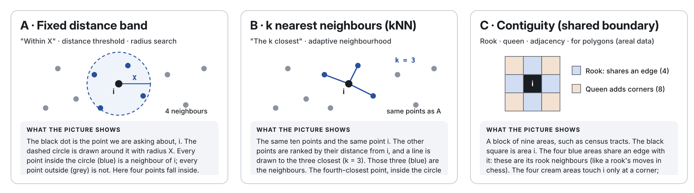

# Homework 5 {#Lab_5 .unnumbered}

```{r, include=FALSE,message=FALSE,warning=FALSE}

## Hidden worked answer
library(readxl)
library(sf)
library(tmap)
library(tidygeocoder)
library(tidyverse)
library(osrm)
library(pheatmap)
library(spdep)
library(sfdep)


medical    <- read_excel("./index_data/G364_MedicalClinics.xlsx")
medical_sf <- st_as_sf(medical,coords=c("Longggitude","latitudE"), crs=4326)


output <- geo("112 Conner Rd, Rolling Fork, MS 39159", method="census")
house_sf <- st_as_sf(output, coords = c("long", "lat"), crs = 4326)
house_sf


# Transform
medical_sf_mercator <- st_transform(medical_sf, 3857)
house_sf_mercator <- st_transform(house_sf, 3857)
medical_sf_utm <- st_transform(medical_sf, 32615)
house_sf_utm <- st_transform(house_sf, 32615)
medical_sf_albers <- st_transform(medical_sf, 5070)
house_sf_albers <- st_transform(house_sf, 5070)


# calculate dist and convert to km
medical_sf_mercator$HouseDist <- st_distance(medical_sf_mercator, house_sf_mercator)/1000
medical_sf_utm$HouseDist <- st_distance(medical_sf_utm, house_sf_utm)/1000
medical_sf_albers$HouseDist <- st_distance(medical_sf_albers, house_sf_albers)/1000


# 
#row.names(medical_sf) <- medical_sf$Name
driving <- osrmTable(
   src = house_sf,
   dst = medical_sf,
   measure = c("distance", "duration")
)


```

### Aim {.unnumbered}

Welcome to Homework 5 - where we focus on distance and neighbourhood. Overall each lab is worth 4.8% and you can drop your lowest score. This is due the night before your next lab. The maximum time it should take is lab time plus about 2-3 hrs of your time.

<br>

### Need help? {.unnumbered}

REMEMBER THAT EVERY TIME YOU RE-OPEN R-STUDIO YOU NEED TO RE-RUN **ALL** YOUR CODE CHUNKS. The easiest way to do this is to press the "Run All" button, in the "Run" menu at the top right of your screen

<br><br>

## PART 1: Lab Setup {.unnumbered}

### STEP 1: Create your project & download data/reports {.unnumbered}

- **[1A]** If you don't already have a folder on your computer for Homework/Lab 5, make one inside your GEOG364 folder. ([Instructions here if you have forgottoen how: Project Tutorial](#T1_Projects))

<br>

- **[1B]** Go to Canvas and download both the data and the lab report template. Put them in your HW5 folder and rename the lab template to include your email ID.

<br>

- **[1C]** Open R-Studio and make a project for Homework 4 in the existing HW5 folder ([Instructions here if you have forgotten how: Project Tutorial](#T1_Projects))

<br>

- **[1D]** Go to the files quadrant/tab and open the RmD Lab report. If you are running your project it should be right there. If it's not, ask a teacher/TA.

<br>

- **[1E]** Optional. You are welcome and encouraged to change the YAML code or use different themes.

  - (Changing the theme to be personal to you does make grading easier! You can see them here - <https://github.com/juba/rmdformats> (scroll down) and all you need to do is change the name of the output in the yaml to that theme name). *Note, unlike last week, we are using the rmdformats package which allows you to make quick professional themes - the website also provides examples you can copy/paste*.

<br>

### STEP 2: Adjust your knit options {.unnumbered}

Look at the first code chunk below the YAML code. The `knitr::opts_chunk$set(echo = TRUE)` command is from the knitr package and allows us to set general options for the entire report.

- **[2A]** Add in two more options, warning=FALSE and message=FALSE as shown below.
- `knitr::opts_chunk$set(echo = TRUE, warning=FALSE, message=FALSE)`

<br>

### STEP 3: Libraries and knitting {.unnumbered}

- **[3A]** You need to install a new library for this to work

- **[3A]** Press save and try to knit. **You should see that you are missing the tidygeocoder package.**. To address this, we need to install it EITHER BY

  - A little yellow bar will appear at the top of the screen asking if you want to install the libraries. Say yes, wait until the libraries are installed and try again. <br>
  - OR when you press knit, you will get an error saying that it can't find that library. In this case, you have to go to the app store and download the `tidygeocoderpackage` ([Instructions here: Packages tutorial](#T2_Libraries_install)) <br>

<br><br>

## PART 2: IN-CLASS {.unnumbered}

In this part of the class, we are going to build on the concept of distance and explore how you can record distances in a spatial weights matrix. You can work as a group and we will go over answers in class to help, but you will be graded/submit this as part of your lab report.

### STEP 4: Load the data and make it spatial {.unnumbered}

You are going to be looking at real data for health care facilities in the Mississippi area.

- **[4A]** Remember to run the library code chunk! In the 'Distances' section of your report, make a new level 2 sub-heading called 'Loading data'.

<br>

- **[4B]** You should have placed the `G364_MedicalClinics.xlsx` in your Lab 5 folder. Use the read_excel command to load the `G364_MedicalClinics.xlsx` file and save it to a variable called medical ([Instructions here: Excel tutorial](#T4_load_excel))

<br>

- **[4C]** View the dataset. There are MANY ways to do this: You can click on its name in "Environment",can type its name in the console, using the names(medical) or glimpse(medical) or head(medical) commands, or using the View(medical) command in the console. <br><br> Try several, and in the text in your report, explain what information each option provides then write down the pros and cons of different approaches for you personally (everyone is different!).

<br>

- **[4D]** The hospital data has the crs code 4326 as its coordinates are stored as longitude and latitude. Use this information and the `st_as_sf()` command to make the data 'Spatial' and call the resulting variable something like medical_sf <br><br> HINT! I am bad at spelling.. ([This is the actual dataset I used in the st_as_sf tutorial, so you can follow that directly if you are unsure](#T5_st_as_sf)).

<br>

- **[4E]** CHECKPOINT. Now type the name of the spatial dataset into the console. You should see that the long/lat columns have disappeared and that R now understands the data is point data. If not, talk to a teacher!

<br><br>

### STEP 5: Quick Exploratory data analysis {.unnumbered}

- **[5A]** Now make another subheading called EDA.

<br>

- **[5B]** Within this section, add code to explore the `medical_sf` dataset. See tutorial 5 or your past labs if you are stuck. Use that output to help you write a bullet point list which explains:
  - The object of analysis
  - The variables (with units).
  - The mean number of doctors per hospital
  - A frequency table showing how many medical facilities are hospitals and how many are clinics ([Tutorial here](#T5_Tables))

<br>

- **[5C]** Make an nice looking interactive map where the color of each dot shows whether the medical facility is a hospital or a clinic. ([QTM reminder here](#T13A_QTM) and [Tmap reminder here](#T13A_TMap) - your choice which route you take)

<br>

- **[5C]** In the text underneath, in about 50 words, explain the spatial pattern that you see of medical facilites and what might cause it.

<br><br>

### STEP 6: Adding in your house data {.unnumbered}

Imagine you are staying in Rolling Fork Mississippi. We are going to calculate the distance from your house to different medical clinics, using different definitions of distance.

- **[6A]** First, you can get the location of your house by using the `geo()` command from the `tidygeocoder` package. Get this code working in your report. <br> (*you can try it on your home address too! there are alternative methods to census if you live abroad, see ?geo* )

```{r, eval=FALSE}
house_sf <- st_as_sf(
  geo("112 Conner Rd, Rolling Fork, MS 39159", method="census"),
  coords = c("long", "lat"), crs = 4326
)
house_sf
```

- **[6B]** Make a new map with the hospitals AND your house marked in red e.g. copy/paste your map code from above, add a + at the end so you can add a new layer, then add something like <br> `tm_shape(house_sf) + tm_dots("red", size=1)` .

<br><br>

### STEP 7: Re-projecting the data {.unnumbered}

We now have two spatial datasets (your house and the medical facilities), but they are currently stored as longitude and latitude. As discussed in class, we know that projecting Longitude and Latitude to a flat map might introduce distortions.

So In this step we are going to transform both datasets into three different projected coordinate systems to see how they change the distances.

- **[7A]** Add a new level 2 sub-heading called 'Map projections'. Look up these three coordinate reference systems (CRS) and in the text, write down their names, units and what each projection was designed for:
  - `3857` (Web Mercator)
  - `32615` (WGS 84 / UTM Zone 15N)
  - `5070` (NAD83 / Conus Albers Equal Area)

<br>

- **[7B]** Use `st_transform()` to re-project the **medical facilities** into all three CRS and save them as new variable names. Here is how to make the first one:

```{r, eval=FALSE, results='hold'}
medical_sf_mercator <- st_transform(medical_sf, 3857)
house_sf_mercator <- st_transform(house_sf, 3857)
```

Now do the other two yourself, giving each a name that makes sense to you.

<br>

- **[7C]** CHECKPOINT. You should end up with a house dataset and a medical facilities dataset in **each** of the three projections. In a sentence, explain why the house and medical facilities should be in the **same** CRS before calculating a Cartesian distance.

<br><br>

### STEP 8: Calculating Cartesian Distances {.unnumbered}

Cartesian distance is the length of a straight line between two points on a flat map. We will calculate it three times to see how much the choice of projection changes the answer.

- **[8A]** Make another level 2 sub-heading called 'Cartesian distances'. Use `st_distance()` to calculate the straight-line distance from your house to **every** medical facility, starting with the Web Mercator datasets.

```{r, eval=FALSE, results='hold'}

# Add a new column with the distance to the house
medical_sf_mercator$HouseDist <- st_distance(medical_sf_mercator, house_sf_mercator)

# convert from m to km, it will still say the [m] in the output table (long story), 
# but it REALLY IS IN KM IF YOU HAVE DIVIDED BY 1000!
medical_sf_mercator$HouseDist <- medical_sf_mercator$HouseDist/1000

```

Note that in the second step, I divide by 1000 to go from metres to km. However, you will notice that the column in the table still says [m] after each number. This is because we are using a shortcut (the "units" package used to formally change units is buggy). So ***we know*** that the distances are now in km because we divided by 1000, but R-Studio still thinks it's in m (and that you divided by 1000 for some other reason).

Now repeat the calculation using **UTM Zone 15N** and **Albers Equal Area**.

<br>

- **[8B]** You can look at the distances by looking at `medical_sf_mercator` and the other two files e.g. in View, you can order the spreadsheet by the `housedist` column, or by a command like

```{r, eval=FALSE, results='hold'}
medical_sf_mercator %>%
     arrange(HouseDist)
```

<br>

- **[8C]** For each of the three map projections, find the distance to the nearest medical facility. Write the name of the facility and the distance in km, with precision to the nearest metre.

<br>

- **[8D]** In about 50 words, explain why the three answers are not the same, Explain which projection you think is most appropriate for measuring straight-line distances in this part of Mississippi, and why. (you might need to do some googling)

<br>

- **[8E]** For your favourite projection, write the distance to the THREE nearest medical facilities. Write the name of the facility and the distance in km, with precision to the nearest metre.

<br><br>

### STEP 9: Calculating Network Distances {.unnumbered}

A patient cannot usually travel in a straight line from their house to a clinic. We can also measure distance **along roads**, and estimate how long the journey would take by car.

- **[9A]** Add a new level 2 sub-heading called 'Network distances'. Load the `osrm` package. We will use the Open Source Routing Machine (OSRM), which finds routes using a road network. This step needs an internet connection.

<br>

- **[9B]** The `osrmTable()` command can calculate the driving distance and travel time between your house and the medical facilities. This actually WANTS the long/lat as input, so we use the medical_sf and house_sf inputs. Here is the code. You just need to make it run.

```{r, eval=FALSE, results='hold'}
driving <- osrmTable(
  src = house_sf,
  dst = medical_sf,
  measure = c("distance", "duration")
)
```

Look inside `driving` to find the distances and travel times. The distances are in **metres** and the times are in **minutes**.

<br>

- **[9C]** Write the THREE closest driving distances (in kilometres) and driving times (in minutes). Compare to your output from step 8. Is the closest clinic by straight-line distance also the closest by road? You can click on points on any of your maps to identify which hospitals they refer to.

<br>

- **[9D]** In about 50 words, explain what is going on and how your definition of distance and the non-uniformity of space impacts the assessment of the healthcare facilities in this area.

<br><br>

## PART 3: HOMEWORK (Spatial weights) {.unnumbered}

### STEP 10: Plotting routes {.unnumbered}

I just found out how to plot each of these routes to the hospitals so that you can actually compare them on the map, so I wanted you to also have the code to to do this. The `osrmTable()` command gives the distance to each medical facility. You can use the `orsmRoute()` command to actually map the route.

- **[10A]** You will need three more libraries (sorry!). Add these to your library code chunk at the top and re-run. If you get an error, install them from the packages app store

```{r, eval=FALSE, results='hold'}
library(spdep) 
library(sfdep)
library(pheatmap)

```

<br>


- **[10B]** Get this code working below in a single code chunk. Then change the code to look at least at one other medical clinic, and see if it can help you better explain your results from step 9. You're also welcome to change the plot if you have a favourite style.

```{r,eval=FALSE, results='hold'}

# All you have to change is the name of the medical clinic you want to see
chosenhospital <- dplyr::filter(medical_sf, Name == "Madison Parish Hospital")

# And driving distance 
Distance_Driving <- osrmRoute(src = house_sf,
                              dst = chosenhospital,
                              overview = "full",osrm.profile="car")

# Create a manual straight line between them
line_between <- st_cast(st_union(house_sf, chosenhospital), "LINESTRING")


# Step 4: Plot both lines and annotate them
tm_shape(line_between)     + 
   tm_lines(col = "red",  lwd = 2, title.col = "Euclidean Line") +
tm_shape(Distance_Driving) + 
   tm_lines(col = "blue", lwd = 2, title.col = "Driving Line") +
tm_shape(house_sf) + 
   tm_dots("red",size=.5) + 
tm_shape(medical_sf) + 
   tm_dots(size=.5)

```

<br><br>

### STEP 11: Spatial distance matrices {.unnumbered}

So far, we've been looking at which medical facilities are closest to our house. However, in spatial analysis, we are often interested in the relationships between all the objects in our dataset. For example, are our hospitals clustered together, or are they spread out evenly across the region? Is there some sort of spatial pattern, and what processes might explain it?

We can record the results in a spatial weights matrix. This is a look-up table telling us which objects are considered neighbours, and sometimes how strongly they are connected.

- **[11A]** To look at the distances between each of the hospitals, we can simply use the same commands, but without the house_sf bit. Get the code working below which calculates the cartesian distance between each of the medical facilities. <br><br>

  To interpret, both the top and side numbers correspond to the row numbers in medical_sf e.g. Row 1 = Madison Parish and Row 6 = South Sunflower, so the distance between those two hospitals is 127172.07m, so 127.1 km.

```{r, eval=FALSE, results='hold'}

# If you don't put a second argument it assumes it wants the distance between each row  
cartesian_dist_matrix <- st_distance(medical_sf_utm)/1000

# Remove the units so we can do maths on the answer
cartesian_dist_matrix <- units::drop_units(cartesian_dist_matrix)

#and print
cartesian_dist_matrix 

```

<br>

- **[11B]** Explain in your report why there are many zeros in the output.

  <br>

**STEPS 11C AND 11D ARE OPTIONAL!**. You don't get credit for them, but it shows how you could use this information if you were actually doing spatial analysis.

- **[11C]** We can do something similar for driving distances. Get this code running in your report

```{r}
  # calculate the driving distance between each hospitals with all the other hospitals
  driving_distances <- osrmTable(
     src = medical_sf,
     dst = medical_sf,
     measure = c("distance", "duration"))

 # convert to km
 driving_dist_matrix <- driving_distances$distances/1000

```

<br>

- **[11D]** This will allow us to see which pairs of hospitals act very differently if you drive compare to direct distances. To visualise this, we first take the difference between the two datasets (e.g. we want the DIFFERENCE between driving and the direct distance). We can then plot it as a heatmap. You will probably need a new package `library(pheatmap)` for this to work

```{r, eval=FALSE, results='hold'}

# Then take the difference. This now shows us how much further we have to go if we drive
differences <-   driving_dist_matrix -  cartesian_dist_matrix

# and make a heatmap, You might need to install/load the pheatmap package for this to work
pheatmap::pheatmap(differences,
         cluster_rows = FALSE,
         cluster_cols = FALSE,
         display_numbers = TRUE,
         number_format = "%.0f",
         color = hcl.colors(100, "Viridis"),
         main = "How many more km do you have to drive between medical facilities \n compared to going directly (by helecopter?) ")

```

**Q to Dr G. What are you looking for in the heatmap above?** I'm looking for variation. In a region where there wasn't a river cutting the domain in half, most cartesian distances would look pretty similar to driving distances, and I would be comfortable using cartesian as my distance measurement for things like analysing clustering. In this case, looking at driving distance *drastically* changes the output, - some hospitals are over 100km further if you drive compared to going direct.

\`

<br><br>

### STEP 12: Closeness (nearest neighbours) {.unnumbered}

I hope it's now clear that your choice of distance matters when thinking about spatial analysis. Once you are happy with that, we then need to think about the concept of "neighbourhood". e.g. which hospitals are "close"/"neighbours" with each other.

As always, there are several ways to think about this, depending on the context and the type of data you have:

```{r, L5-Neighbors, echo=FALSE, fig.cap="Three ways of thinking about neighbors", out.width="100%"}

```

We're going to try a few in R. For points/spatial objects, like our hospitals, the concept of adjacency doesn't make much sense. So we can either decide that points are neighbours if they are the "X" Closest neighbours, or if they are within a certain distance band.

<br>

**Please use sub-headings as necessary to make your report tidy and easy to follow**

<br>

- **[12A]: Cartesian Nearest Neighbours** The st_knn command looks through your dataset and works the nearest neighbours for every hospital (using cartesian distance.). You decide how many nearest neighbours using the k argument inside st_knn.

```{r, eval=FALSE, results='hold'}

# i've chosen the UTM data, you can choose your favourite.
# Find the 2 nearest neighbours (k = 2)
medical_nn <- st_knn(medical_sf_utm, k = 2)
medical_nn

# See the entire grid of nearest neighbours
nb_as_matrix(medical_nn)

```

Get this running. Then **edit** **the code and re-run** to work out the THREE nearest neighbours to the Sharkey Issaquena community hospital and write down your answer in the text (hint, find which row the sharkey hospital is on in the dataset then use that to interpret the output).

<br>

- **[12B]** Also get this code working to plot the data

```{r,eval=FALSE, results='hold'}

# Convert nearest-neighbour relationships into lines
medical_lines <- st_as_edges(
                      st_geometry(medical_sf_utm), medical_nn)

# Map the lines and hospital locations
tm_shape(medical_lines) +
  tm_lines(col = "steelblue", lwd = 2) +
tm_shape(medical_sf_utm) +
  tm_dots(fill = "black", size = 0.5)


```

<br>

- **[12C] Network/Driving based nearest neighbours**. There isn't actually easy code to work out the nearest neighbours according to a network (say driving distance). So for this section, get the code working, then change k from k=2, to k=3,4,5 etc. and explain in the text what you see and how the pattern differs from the cartesian nearest neighbour

```{r, eval=FALSE, results='hold'}

# choose the number of nearest driving neighbours
k = 2

# Driving distances between every pair of hospitals (metres)
drive_distTable <- osrmTable(loc = medical_sf_utm,measure = "distance")

# Extract just the distance matrix
drive_dist <- drive_distTable$distances


# Exclude each hospital's distance to itself by setting that to infinity
diag(drive_dist) <- Inf

# Identify the 2 closest hospitals by road
# Programmers/mathematicians, see if you can work out what i'm doing in this code!
medical_nn_matrix <- t(apply(drive_dist, 1, function(x)
  as.integer(rank(x, ties.method = "first") <= k)))


# Convert matrix into a neighbours list
medical_nn_driving <- spdep::mat2listw(
  medical_nn_matrix, style = "B"
)$neighbours


# Then the rest is identical to before
medical_nn_driving

# Binary neighbours matrix (0 and 1)
nb_as_matrix(medical_nn_driving)

# and plot
# Convert neighbours into spatial lines
medical_lines_driving <- st_as_edges(
  st_geometry(medical_sf_utm),
  medical_nn_driving
)

# Map the lines and hospital locations
tm_shape(medical_lines_driving) +
  tm_lines(col = "red", lwd = 2) +
tm_shape(medical_sf_utm) +
  tm_dots(fill = "black", size = 0.5)


```

<br><br>

### STEP 13: Closeness (Distance bands) {.unnumbered}

Your nearest neighbours might actually be very far away. So a different way to consider "close" or neighbourhood is by looking at how many hospitals are within a particular **distance band**.

For example, we might decide that all hospitals within 60 km of each other are neighbours. This means that some hospitals might have lots of neighbours, while others might only have one (or even none!). Unlike the nearest-neighbour approach, we are **not** forcing every hospital to have the same number of neighbours.

<br>

- **[13A]** **Cartesian distance bands**. The `st_dist_band()` command finds all the neighbours within a distance that you choose. Because we're using our UTM data, distances are measured in **metres** (so 60 km = 60,000 m). <br><br> Get this code working in your report. Have a look at the neighbour list and the matrix of 0s and 1s.

```{r, eval=FALSE, results='hold'}
# Find all hospitals within 60 km of each other
medical_band <- st_dist_band(medical_sf_utm, upper = 60000)
medical_band

# See the entire grid of neighbours
nb_as_matrix(medical_band)
```

<br>

- **[13B]** Now make a map showing the hospitals connected to their distance-band neighbours. You can **copy and adapt the code from [12B]**, using `st_as_edges()` to turn your new neighbour list (medical_bands) into lines and `tmap` to plot them.

<br>

- **[13D]** Find the **Sharkey Issaquena Community Hospital** in your dataset. Using a distance band of 20km, write down which other medical facilities count as its neighbours.

<br><br>

### STEP 14: Reflection {.unnumbered}

Create a new heading called reflection and answer these questions

- **[14A]** Explain what a spatial weights matrix is and why it's important

<br>

- **[14B]** For each of these scenarios, explain which definition of "neighbour" (from steps 12 & 13) you would you use and why
  - **Scenario A:** Which hospitals should each hospital contact first when arranging an ambulance transfer?
  - **Scenario B**: Which hospitals should each hospital contact first when arranging an helicopter ambulace transfer?
  - **Scenario C:** Which hospitals are within a helicopter's maximum flight range and could provide emergency assistance?
  - **Scenario D:** Which hospitals could send an ambulance or to help within 30 minutes?

<br>

- **[14A].** As I have mentioned a few times in class, common sense can often do better than complex statistics. What I really mean by this is that the non-uniformity of space is incredibly important when considering spatial data and understanding the geography of an area can completely change how we interpret and analyse a dataset. <br><br> **Look closely at the map.** Write down any other geographical features can you see that might influence how 'close' medical facilities are to one another, particularly when considering how easily they could share resources, staff or patients? Explain your reasoning.

<br><br>

### **Congrats! Finished!** {.unnumbered}

## WHAT TO SUBMIT {.unnumbered}

<br>

### If you are using your own computer {.unnumbered}

1.  Press knit one final time. You will have created two files; a `.Rmd` file containing your code and a `.html` file for viewing your finished document.

2.  Find the html and RmD files in your Lab 4 folder on your computer. Double click the html file to open it in your browser and check it's the one you want to submit.

3.  **You need to submit BOTH of these files on the relevant Canvas assignment page.**

```{r, L5-Submit, echo=FALSE, fig.cap="Find them in your GEOG364 folder on your computer", out.width="100%"}
knitr::include_graphics('./index_images/im_T1_WhattoSubmit.png')
```

<br>

### If you are using Posit Cloud online {.unnumbered}

1.  Press knit one final time.You will have created two files; a `.Rmd` file containing your code and a `.html` file for viewing your finished document.

2.  Go to the files tab an click on the little check-box by the RmD file. Then click the blue "more button" and press export. Save onto your computer.

3.  Uncheck the .RmD box and click the box by the html file. Then click the blue "more button" and press export. Save onto your computer.

4.  **You need to submit BOTH of these files on the relevant Canvas assignment page.**

```{r, L5-CloudDownload, echo=FALSE, fig.cap="How do download the files from PositCloud", out.width="100%"}
knitr::include_graphics('./index_images/im_T1_CloudSubmit.png')
```

<br><br>

## CHECK YOUR GRADE! {#CheckGradeL5 .unnumbered}

### RUBRIC {.unnumbered}

See canvas
