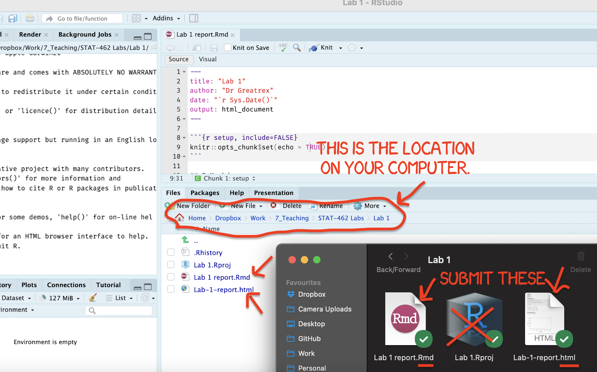
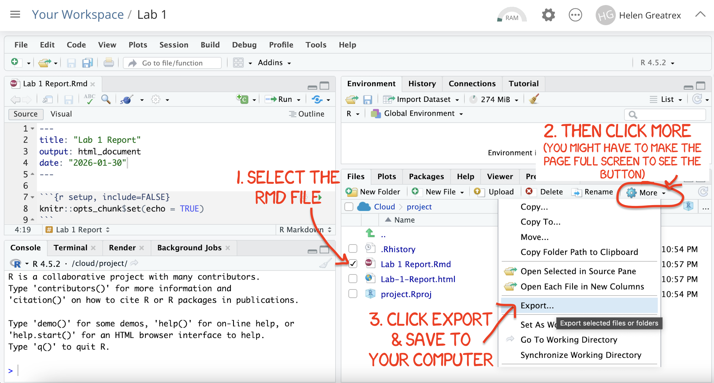

# Project 2 {#Project2 .unnumbered}

```{r, include=FALSE,message=FALSE,warning=FALSE}

## Hidden worked answer
library(readxl)
library(sf)
library(tmap)
library(tidygeocoder)
library(tidyverse)
library(osrm)
library(pheatmap)
library(spdep)
library(sfdep)


```

### Aim {.unnumbered}

Welcome to Project-2. This is worth 100 points! You can drop your lowest score out of the three projects.

YOU HAVE TWO WEEKS! The maximum time it should take is about 4-6 hrs of your time, plus both lab times.

The aim of this lab is to showcase your ability to think about spatial EDA, distance/neighbourhood and autocorrelation. <br> <br>

### Need help? {.unnumbered}

REMEMBER THAT EVERY TIME YOU RE-OPEN R-STUDIO YOU NEED TO RE-RUN **ALL** YOUR CODE CHUNKS. The easiest way to do this is to press the "Run All" button, in the "Run" menu at the top right of your screen

<br><br>

## PART 1: Lab Setup {.unnumbered}

### STEP 1: Create your project & download data/reports {.unnumbered}

- **[1A]** If you don't already have a folder on your computer for Project2, make one inside your GEOG364 folder. ([Instructions here if you have forgottoen how: Project Tutorial](#T1_Projects))

<br>

- **[1B]** Go to Canvas and download both the data and the lab report template. Put them in your Project2 folder and rename the lab template to include your email ID.

<br>

- **[1C]** Open R-Studio and make a project for Project 2 in the existing Project2 folder ([Instructions here if you have forgotten how: Project Tutorial](#T1_Projects))

<br>

- **[1D]** Go to the files quadrant/tab and open the RmD Lab report. If you are running your project it should be right there. If it's not, ask a teacher/TA.

<br>

- **[1E]** Optional. You are welcome and encouraged to change the YAML code or use different themes.

  - (Changing the theme to be personal to you does make grading easier! You can see them here - <https://github.com/juba/rmdformats> (scroll down) and all you need to do is change the name of the output in the yaml to that theme name). *Note, unlike last week, we are using the rmdformats package which allows you to make quick professional themes - the website also provides examples you can copy/paste*.

<br>

### STEP 2: Adjust your knit options {.unnumbered}

Look at the first code chunk below the YAML code. The `knitr::opts_chunk$set(echo = TRUE)` command is from the knitr package and allows us to set general options for the entire report.

- **[2A]** Add in two more options, warning=FALSE and message=FALSE as shown below.
- `knitr::opts_chunk$set(echo = TRUE, warning=FALSE, message=FALSE)`

<br>

### STEP 3: Libraries and knitting {.unnumbered}

- **[3A]** Press save and try to knit. If you find you are missing libraries your need to install them EITHER BY

  - A little yellow bar will appear at the top of the screen asking if you want to install the libraries. Say yes, wait until the libraries are installed and try again. <br>
  - OR when you press knit, you will get an error saying that it can't find that library. In this case, you have to go to the app store and download the missing package ([Instructions here: Packages tutorial](#T2_Libraries_install)) <br>

<br><br>

## PART 2: NOTES {.unnumbered}

**CREATE A NEW HEADING CALLED NOTES**

### STEP 4: Summarise notes {.unnumbered}

**Here is your reading - Chapter 13 until 13.4.1 of Dr Girmond's Spatial Data Science**

- <https://mgimond.github.io/Spatial/13_autocorrelation.html>

- STOP AT 13.4.2! "Multiple Comparisons and False Discovery Rate"

In your notes, I want you to explain thoughtfully in your own words:

1.  Why do geographers care about spatial autocorrelation? Or what would the world be like without it (and what's the name of the pattern and process from the lecture notes that we describe it)

2.  Using the 10A lecture notes/recording from Monday to help, what is Moran's I? Why is it a global statistic?

3.  What does spatial lag mean?

4.  What does a positive value of moran's I represent?

5.  What is "Local Moran's I" (we will discuss on Wednesday)

<br><br>

### STEP 5: Make yourself a mini tutorial {.unnumbered}

I have recreated some of Dr Giramond's results in Tutorial 14 and given you the code (but not run it).

**HERE IS THE LINK - <https://psu-spatial.github.io/Geog364-2026/T14_Autocorrelation.html>**

- **[5A]** Create a new sub-heading called "Tutorial".

- **[5B]** Follow the tutorial, putting the code into your own report and running it, then IN YOUR OWN WORDS, explaining what is happening in each code chunk/what the results mean, (An A\* report will link this to the class theory above)

- This stops before we get to LISA as I want to discuss it in class first, but I will use the same data as the class example\

<br><br>

## PART 3: MAIN PROJECT (Moran's I) {.unnumbered}

**CREATE A NEW HEADING CALLED CHICAGO PROJECT**

You are an urban planner working for the City of Chicago, tasked with helping decide where to prioritise future investment in urban development, green spaces and tree planting.

Your office is concerned about geographical inequalities across the city. In particular, you want to understand whether differences in wealth, poverty and housing conditions are becoming more geographically concentrated or dispersed over time, and whether similar patterns exist in the distribution of urban tree cover.

You have been given census tract data for **2010 and 2018**. Your task is to use spatial statistics, including **Global Moran's I and LISA**, to investigate how these patterns have changed, identify neighbourhoods where inequalities persist, and consider what your findings might mean for future planning decisions.

<br><br>

### STEP 5: Explain why we care {.unnumbered}

- **[5A]** Create a new sub-heading called "Introduction". Use subheadings within this section to make your answers easy to follow

<br>

- **[5B]** Before beginning your analysis, you should to understand why these questions matter to urban planners. Read the following three resources:

  1.  **BBC Future:** [How to cool down urban heat islands](https://www.bbc.com/future/article/20240613-how-to-cool-down-urban-heat-islands-in-americas-heatwaves?utm_source=chatgpt.com)

  2.  **The New York Times:** [How decades of racist housing policy left neighbourhoods sweltering](https://www.nytimes.com/interactive/2020/08/24/climate/racism-redlining-cities-global-warming.html?utm_source=chatgpt.com) (you can log in by clicking institutional log in then using your PSU address)

  3.  **The Morton Arboretum:** [Maps and data to guide local action for trees](https://mortonarb.org/plant-and-protect/chicago-region-trees-initiative/maps-and-data-to-guide-local-action-for-trees/?utm_source=chatgpt.com)

<br>

- **[5C] In your report, in approximately 150 words, explain why your planning office would be interested in the geographical distribution of wealth, poverty and tree cover across Chicago. Refer to the articles above.**

  In your answer, consider how historical inequalities might affect present-day living conditions, why tree cover matters for urban communities, and how organisations such as the Morton Arboretum are using geographical data to inform decisions.

  Finally, explain why it might be useful to know whether these geographical patterns are changing over time, rather than simply examining the situation in 2018.

<br>

- **[5D] In your report, in approximately 50-100 words, explain why your planning office would be interested in the spatial autocorrelation of wealth, poverty and tree cover across Chicago, and how this links to pattern and the underlying processes.**

<br><br>

### STEP 6: Explore the data {.unnumbered}

### Dataset: Chicago Census Tracts (2018)

- **The `ChicagoTracts_2018` dataset contains demographic, socioeconomic and environmental information for census tracts across Chicago for the year 2018.**

- **The `ChicagoTracts_2010` dataset contains demographic, socioeconomic and environmental information for census tracts across Chicago for the year 2010.**

- In both, each row represents a census tract, with an associated polygon showing its geographical boundaries.

The dataset contains the following variables:

| Variable | Description |
|----|----|
| `GEOID` | Unique census tract identifier |
| `arealand_sqmiles` | Land area of the tract (square miles) |
| `canopy_2018` | Percentage of the tract covered by tree canopy |
| `population_2018` | Total population |
| `pop_density_2018` | Population per square mile |
| `pct_poverty_2018` | Percentage of residents living below the poverty threshold |
| `med_income_2018` | Median household income (\$) |
| `med_rent_2018` | Median monthly rent (\$) |
| `med_value_2018` | Median home value (\$) |
| `pct_vacant_2018` | Percentage of housing units that are vacant |
| `pct_white_2018` | Percentage of residents identified as White |
| `pct_black_2018` | Percentage of residents identified as Black |
| `pct_hispanic_2018` | Percentage of residents identified as Hispanic or Latino |
| `pct_degree_2018` | Percentage of residents with a college degree |
| `geometry` | Census tract boundaries (MULTIPOLYGON) |

Most variables come from the **2018 American Community Survey (ACS)**, which provides census tract-level estimates of population characteristics, income, poverty, housing and education. Tree canopy coverage was calculated separately using **LiDAR (Light Detection and Ranging)** data.

<br>

- **[6A]** Go to Canvas, download the two datasets and put them into your Project 2 folder.

<br>

- **[6B]** Read in each dataset using the `st_read()` command.

<br>

- **[6C]** Using your code from previous labs, explore the data and make some maps of the variables

  - Hint, the `tmap_arrange()` function will let you put two maps together to compare them. I'll show an example in class.

<br>

- **[6D]** Describe any patterns you see, and any potential processes that cause them. Chicago has been studied a lot! Do some googling :)

<br>

- **[6E]** CHOOSE ONE VARIABLE that you think would be interesting to compare between 2010 and 2018. When I say compare, I mean compare the spatial autocorrelation (e.g. clustering/gridlike patterns). Clearly write down your choice (make a sub-sub-heading or something)

<br>

- **[6E]** Based on the 2010 map for that variable and the 2018 map, make a prediction about whether you think the data has become more clustered, less clustered etc..

<br><br>

### STEP 7: Calculate the change in that variable {.unnumbered}

<br><br>

TO BE CONTINUED - INSTRUCTIONS WILL BE ADDED BEFORE WEDNESDAY 28th. (but know you have done most of the hard coding)

### **Congrats! Finished!** {.unnumbered}

## WHAT TO SUBMIT {.unnumbered}

<br>

### If you are using your own computer {.unnumbered}

1.  Press knit one final time. You will have created two files; a `.Rmd` file containing your code and a `.html` file for viewing your finished document.

2.  Find the html and RmD files in your Lab 4 folder on your computer. Double click the html file to open it in your browser and check it's the one you want to submit.

3.  **You need to submit BOTH of these files on the relevant Canvas assignment page.**

```{r, P2-Submit, echo=FALSE, fig.cap="Find them in your GEOG364 folder on your computer", out.width="100%"}

```

<br>

### If you are using Posit Cloud online {.unnumbered}

1.  Press knit one final time.You will have created two files; a `.Rmd` file containing your code and a `.html` file for viewing your finished document.

2.  Go to the files tab an click on the little check-box by the RmD file. Then click the blue "more button" and press export. Save onto your computer.

3.  Uncheck the .RmD box and click the box by the html file. Then click the blue "more button" and press export. Save onto your computer.

4.  **You need to submit BOTH of these files on the relevant Canvas assignment page.**

```{r, P2-CloudDownload, echo=FALSE, fig.cap="How do download the files from PositCloud", out.width="100%"}

```

<br><br>

## CHECK YOUR GRADE! {#CheckGradeP2 .unnumbered}

### RUBRIC {.unnumbered}

See canvas
