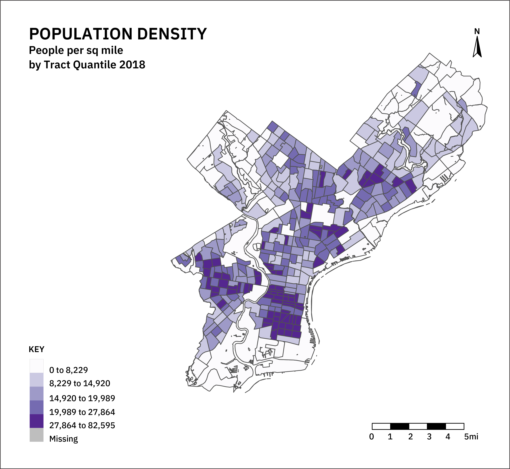
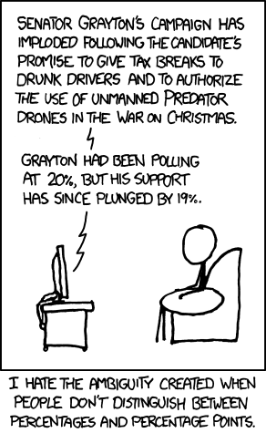
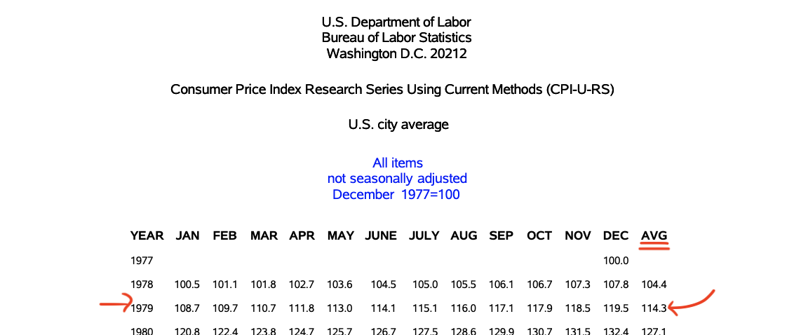
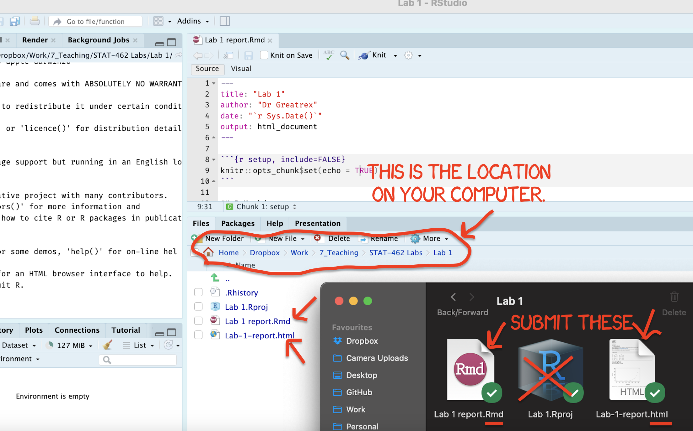
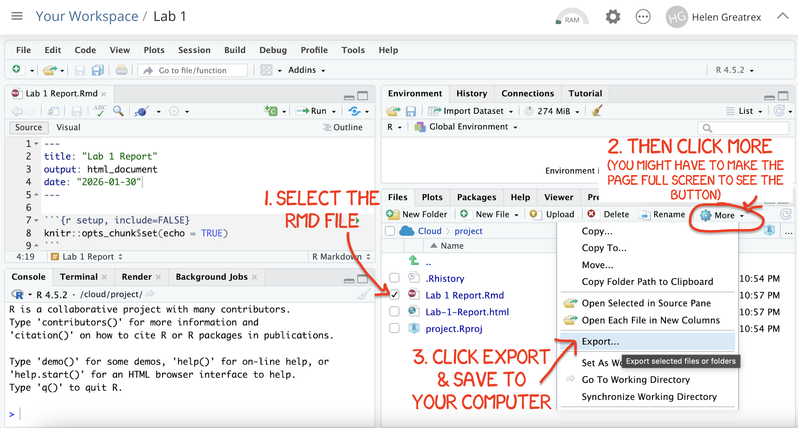

# Project 2 - IMPROVED INSTRUCTIONS {.unnumbered}

```{css, echo=FALSE, file="projectlab.css"}
```

```{r, include=FALSE,echo=FALSE, eval=FALSE, warning=FALSE, message=FALSE}

# NOTES
# THIS COULD BECOME AN ENTIRE SEMESTER LONG PROJECT
#      E.G STEP 1, THEY CHOOSE A CITY/GET CENSUS DATA AND A TOPIC
#      THEY CHOOSE A MAP PROJECTION & DO QUALITY CONTROL/REMOVE
# TALK ABOUT EDGE EFFECTS/MAUP - (could they?? or does that just not fit)
# I COULD GIVE THEM 5 CITIES WHERE I THINK IT WOULD WORK AND A LIST OF VARIABLES TO CHOOSE FROM
# (e.g. they choose 5)

```

```{r, include=FALSE,echo=FALSE, warning=FALSE, message=FALSE}

knitr::opts_chunk$set(eval = TRUE, 
                      fig.show = "hide", 
                      message = FALSE, 
                      warning = FALSE)

# Libraries
library(tidyverse)
library(AER)
library(broom)
library(ggplot2)
library(kableExtra)
library(openintro)
library(readxl)
library(skimr)
library(sp)
library(sf)
library(plotly)
library(tmap)
library(viridis)
library(elevatr)
library(osmdata)


# Data

```


## About the lab {.unnumbered}

### IMPORTANT! {.unnumbered}

**The original Project 2 requirements and grading rubric are unchanged. The additional examples, suggested word counts and guidance in these revised instructions are intended to help you understand what good work looks like, and do not introduce new requirements. 

This is a rewrite of the project 2 instructions. I'm asking you to do exactly the same thing as before, but I have included a lot more detail about what I mean by terms like "explore the data".  To do this, I broke up Step 6 into 3 parts (introduction/background, then making the maps & statistics, then writing up your interpretation). You don't *have* to use this, but I hope it is helpful.

-  **If you haven't started or you're only partway through the lab,** I suggest using these new instructions 
 
-  **If you've completed the lab,** I suggest looking at STEP 6C especially just to check your answers and add anything that you missed that might lead to a higher grade. STEP 6B also includes improved code for comparing across different timescales (e.g. the maps will now have the same color scale & zoom in sync)** 

<br>

### Lab aim {.unnumbered}

The aim of this lab is to showcase your ability to think about spatial EDA, distance/neighbourhood and autocorrelation.

This is worth 100 points and you can drop your lowest score out of the three projects.

Because this is worth 100 points, I expect it to take more time than a standard lab.
Expect it to take the 4 hours of in class lab time, plus about another 6-10 hours of your own time (so about 2-3 hrs homework per week).

<br>

<p class="comment">

::: {#boxgreen}
- **This is a THREE WEEK LAB - THE DEADLINE IS NOV-17**

- See [the Canvas page](https://psu.instructure.com/courses/2465664/assignments/18709078) for assignment guidelines.

- You must submit an `.Rmd` file and its associated `.html` file.
:::

<br>

::: {#boxblue}
**Getting help**

- Samrin (and often Dr G) will be present during your lab sessions.
  This is the easiest way to get help!

- Dr G AND Samrin have weekly office hours and genuinely enjoy helping you with R.

- You may send a Canvas message to Samrin or Dr G.
:::

------------------------------------------------------------------------

<br><br>

## PART A: LAB-SETUP {.unnumbered}

<br>


### STEP 1: Create your project & download data/reports {.unnumbered}

- **[1A] Make a Project 2 folder**
  - Go to the GEOG364 folder on your computer.
  - Make a subfolder called Project2.

<br>

- **[1B] Download the data**
  - Go to [the Canvas page](https://psu.instructure.com/courses/2465664/assignments/18709078).
  - Download the data and lab report template, and them in your Project2 folder.
  - Rename the lab template to include your email ID.

<br>

- **[1C] Make a Project**
  - Open R-Studio.
  - Go to the File menu and make a New Project in the existing Project2 folder.
  - ([Instructions here if needed: Project Tutorial](#T1_Projects))

<br>

- **[1D] Open the lab script**
  - Go to the files quadrant/tab and open the RmD Lab report.
  - If you are running your project it should be right there. If it's not, ask a teacher/TA.

<br><br>

### STEP 2: Adjust your theme and knit options  {.unnumbered}


- **[2A] Adjust the knit options** <br> *Your top code chunk allows you to set general options for all the code in your final report. echo=TRUE means show all your code, cache = FALSE tells the computer to freshly download the data when it knits,message=FALSE, warning=FALSE stop the library loading text and any warnings.*

  - In your report, find the first code chunk below the YAML code that starts `knitr::opts_chunk$set`.

  - Adjust your code chunk so that it looks identical to this: <br> `knitr::opts_chunk$set(echo = TRUE, cache = FALSE, message=FALSE, warning=FALSE)`

<br>

- **[2B] Change the theme** (Optional but encouraged).
  <br> *We are using the `rmdformats` package which has many in-built themes that can be adjusted with a single word. Changing the theme makes your report look unique to you and makes it easier for us to grade.*

  - To see the themes, go to <https://github.com/juba/rmdformats> and scroll down.
    Note the name of the theme you want.

  - Go back to your report and scroll to the very top to look at the YAML code.
    Find the line that starts `rmdformats::`.

  - Change the word `robobook` or `material` to the name of the theme you want, making sure to keep all the colons.
    For example, your line might look like `rmdformats::robobook:`, `rmdformats::downcute:`, `rmdformats::material:`.

<br>

### STEP 3: Try to knit & check libraries are installed {.unnumbered}

- **[3A] Press save and try to knit.**

  - If you find you are missing libraries, or you got your YAML updates wrong, you will get an error.

  - If you are missing libraries, a little yellow bar will probably appear at the top of the screen asking if you want to install them.
    Say yes, wait until the libraries are installed and try again.

  - Occasionally the little yellow bar doesn't appear and when you press knit, you will get an error saying that it can't find that library.
    In this case, you go to the "app store" and download the missing package ([Instructions here: Packages tutorial](#T2_Libraries_install)) <br>

------------------------------------------------------------------------

<br><br>

## PART B: NOTES AND TUTORIALS {.unnumbered}

### STEP 4: summarise your notes {.unnumbered}

- **[4A] Read this chapter:** Chapter 13 of Dr Girmond's Spatial Data Science: <https://mgimond.github.io/Spatial/13_autocorrelation.html>, from the start until until 13.4.1.
  \*\*

  - STOP AT 13.4.2! "Multiple Comparisons and False Discovery Rate"

<br>

- **[4B] In your report, thoughtfully explain in your own words**

  - [1] Why do geographers care about spatial autocorrelation?

  - [2] Would the world look like without spatial autocorrelation (and what are the formal names of the pattern and process that describe this. (see the lecture notes)

  - [3] Using the 10A lecture notes/recording from Monday to help, Describe Moran's I and explain why it's a global statistic.

  - [4] What does spatial lag mean?

  - [5] What does a positive value of moran's I represent?

  - [6] Describe "Local Moran's I"

<br>

### STEP 5: Morans I mini tutorial {.unnumbered}

- **[5A] Create a new sub-heading called "Tutorial".**

- **[5B] Reproduce the tutorial with your own commentary** <br>I have recreated some of Dr Giramond's results in Tutorial 14 and given you the code (but not run it) - see [Tutorial 14: Autocorrelation](#T14_Autocorrelation).

  - **Reproduce the analysis:** Copy the code from Tutorial 14 into your own report and run it.

  - **Explain the code:** Describe, in your own words, what each code chunk is doing and why.The more specific the better.

  - **Interpret the output:** Explain what the outputs tell you about spatial autocorrelation.
    Demonstrate a deeper understanding by linking the your tutorial to concepts from class and the reading above.

------------------------------------------------------------------------

<br><br>

## PART C: MAIN PROJECT {.unnumbered}

### Background/introduction {#P2b_Background .unnumbered}

You are an urban planner working for the City of Chicago, tasked with helping decide where to prioritise future investment in urban development, green spaces and tree planting.

Your office is concerned about geographical inequalities across the city.
In particular, you want to understand whether differences in wealth, poverty and housing conditions are becoming more geographically concentrated or dispersed over time, and whether similar patterns exist in the distribution of urban tree cover.

You have been given census tract data for **2010 and 2018**.
Your task is to use spatial statistics, including **Global Moran's I and LISA**, to investigate how these patterns have changed, identify neighbourhoods where inequalities persist, and consider what your findings might mean for future planning decisions.

**Datasets:**

- **The `ChicagoTracts_2018` dataset** contains demographic, socioeconomic and environmental information for census tracts across Chicago for the year 2018.

- **The `ChicagoTracts_2010` dataset** contains demographic, socioeconomic and environmental information for census tracts across Chicago for the year 2010.

- Most variables come from the **2018 American Community Survey (ACS)**, which provides census tract-level estimates of population characteristics, income, poverty, housing and education.
  Tree canopy coverage was calculated separately using **LiDAR (Light Detection and Ranging)** data.

- In both, each row represents a census tract, with an associated polygon showing its geographical boundaries.

The dataset contains the following variables:

+-----------------------------------+------------------------------------------------------------+
| Variable                          | Description                                                |
+===================================+============================================================+
| `GEOID`                           | Unique census tract identifier                             |
+-----------------------------------+------------------------------------------------------------+
| `arealand_sqmiles`                | Land area of the tract (square miles)                      |
+-----------------------------------+------------------------------------------------------------+
| `canopy_2018`                     | Percentage of the tract covered by tree canopy             |
+-----------------------------------+------------------------------------------------------------+
| `population_2018`                 | Total population                                           |
+-----------------------------------+------------------------------------------------------------+
| `pop_density_2018`                | Population per square mile                                 |
+-----------------------------------+------------------------------------------------------------+
| `pct_poverty_2018`                | Percentage of residents living below the poverty threshold |
+-----------------------------------+------------------------------------------------------------+
| `med_income_2018`                 | Median household income (\$)                               |
+-----------------------------------+------------------------------------------------------------+
| `med_rent_2018`                   | Median monthly rent (\$)                                   |
+-----------------------------------+------------------------------------------------------------+
| `med_value_2018`                  | Median home value (\$)                                     |
+-----------------------------------+------------------------------------------------------------+
| `pct_vacant_2018`                 | Percentage of housing units that are vacant                |
+-----------------------------------+------------------------------------------------------------+
| `pct_white_2018`                  | Percentage of residents identified as White                |
+-----------------------------------+------------------------------------------------------------+
| `pct_black_2018`                  | Percentage of residents identified as Black                |
+-----------------------------------+------------------------------------------------------------+
| `pct_hispanic_2018`               | Percentage of residents identified as Hispanic or Latino   |
+-----------------------------------+------------------------------------------------------------+
| `pct_degree_2018`                 | Percentage of residents with a college degree              |
+-----------------------------------+------------------------------------------------------------+
| `geometry`                        | Census tract boundaries (MULTIPOLYGON)                     |
+-----------------------------------+------------------------------------------------------------+

<br>

### STEP 6. A) Write up background {.unnumbered}

Before getting started with data analysis, it's important to understand the context of the study, or you might miss interesting nuances in the data.

- **[6Ai] Set up your report.** Create a new heading called "Chicago Project", and underneath, create a new sub-heading called "Study aim and background".

<br>

- **[6Aii] Read the following three resources:**

  - **BBC Future:** [How to cool down urban heat islands](https://www.bbc.com/future/article/20240613-how-to-cool-down-urban-heat-islands-in-americas-heatwaves)

  - **The New York Times:** [How decades of racist housing policy left neighbourhoods sweltering](https://www.nytimes.com/interactive/2020/08/24/climate/racism-redlining-cities-global-warming.html) (you can log in by clicking institutional log in then using your PSU address).

  - **The Morton Arboretum:** [Maps and data to guide local action for trees](https://mortonarb.org/plant-and-protect/chicago-region-trees-initiative/maps-and-data-to-guide-local-action-for-trees/)

<br>

- **[6Aiii] Explain the study aim & why your planning office cares. (100-300 words).** <br> It doesn't need to follow this structure exactly, but an excellent answer would include
  - A summary of the report aim from the [Lab Background](#P2b_Background)
  - An explanation of why your planning office would be interested in the geographical distribution of wealth, poverty and tree cover across Chicago, that refers to the three articles above for specific points.
  - An explanation of how how historical inequalities might affect present-day living conditions, why tree cover matters for urban communities, and how organisations such as the Morton Arboretum are using geographical data to inform decisions.

<br>

- **[6Aiv] Explain the link to spatial statistics (100-300 words)**. <br> In the next paragraph, explain these two points:
  - Why it might be useful to know whether these geographical patterns are changing over time, rather than simply examining the situation in 2018.
  - An explanation of what spatial autocorrelation is (including what positive, negative and zero autocorrelation means) and why your planning office would be interested in this to achieve their goals. e.g. how does understanding spatial autocorrelation help officials to describe patterns and understand the processes that cause them.
  
  
<br>

- **[6Av] Set up the report.** Create a new sub-heading called "Initial Data Analysis".

<br><br>


### STEP 6. B) Create maps & summary statistics {.unnumbered}


**This step is exploration only. Your code and maps can stay in your report, but you don't need to write about them until step 6C** Keep notes as you go, because in Step 6C you will turn them into your write-up. If it helps, read step 6C first, so you know what to look out for.

In this step you will get to know the 2018 data, choose one variable to focus on, and look closely at how it varies across Chicago.


<br>

- **[6Bi] Read in the data.** Read in both the 2010 and 2018 datasets using st_read ([Reminder here: Loading Data Tutorial](#T4_ReadingData)).
  - *Side note: For most of this step we will only work with `ChicagoTracts_2018`, but if you do want to look at the 2010 version, remember it's easy to adjust the code; simply copy/paste the code and change the 2018s to 2010s (this is why I standardise file/column names.)*

<br>

- **[6Bii] Get to know the 2018 dataset.**
  - Look at the spreadsheet itself and calculate summary statistics for the 2018 data ([Reminder here: Summary Tutorial](#T5_Summarising) ).
  - Take 5 minutes to make sure you understand the following. You will write it up in step 6C.
    - The object of analysis (what one row represents) and how many objects/tracts there are
    - What each column represents and its units. Compare your data to the list of variables in the [Lab Background](#P2b_Background) so that you understand what each column contains and can interpret the numbers.
    - Whether there's anything that might cause problems. For example, missing values, or if values that appear clearly wrong or unrealistic (e.g. a negative number of people, or a rainfall of 999)
      - There shouldn't be any problems in this lab, but in general, this is a good point to fix those issues, using the dplyr::filter command to make a new dataset for the rest of the lab.
  - Advanced: *If you're finding this lab easy, also note if there are any counties/tracts with very few residents (such as the airport, or large parks or the lake) as they can impact percentage calculations.*

<br>

- **[6Biii] Make a variable shortlist.** Think about the study aim from your introduction and the [Lab Background](#P2b_Background). Choose 3–4 variables you think matter for the planning office or that you are interested in investigating (i.e. you don't need to look at every variable in the dataset).

<br>

- **[6Biv] Start making some maps & choose your primary variable.** The aim of this is to choose a single variable that supports the needs of the planning office and whose spatial pattern interests you most.

  - Make an interactive map of your shortlisted variables and look at the patterns.
    To make maps quickly, you could adjust the code below, or use code from your previous labs.
    (there's also more examples of Tmap code lower down)

    ```{r, eval=FALSE}
    # Make the map interactive
    tmap_mode("view")

    # Map in a slightly transparent way with no borders
    # Remember to replace datasetname and columnname with your data
    qtm(datasetname, fill="columnname", fill_alpha=.6, col=NULL)
    ```

  - Choose a variable that supports the needs of the planning office and whose spatial pattern interests you (or will give you interesting results from an autocorrelation perspective.

<br>

- **[6Bv] Look closely at the map of your primary variable,** You will write this up in step 6C. <br>
  - If you haven't already, zoom in and out of the map you made above Imagine you had to describe this map to someone on the phone or to someone who is blind. Think about how you could you describe it so that their drawing of the map looks like yours.
  - To help with this:
    - Explore how your pattern aligns with the background map. e.g. downtown, the lakefront, train lines, parks, industrial areas, or the redlined areas from the New York Times article.
      - *To work out what neighbourhood something is in, I typically zoom in and look for a nearby school or park then google it. I also google things like tourism maps so I can get a sense of a new city and its main neighbourhoods.*
    - Look for any interesting spatial features that you see (especially those linked to autocorrelation) and note where they are on the background map.
      - *For example, where are the cold/hotspots, Do you see large smooth clusters? Randomness? a gridlike or chessboard pattern? A smooth gradient? Scattered extremes? (which tracts? where are they).*
    - Start thinking about process and ask yourself why you the pattern looks like this. Note anything easy, e.g. your variable gets higher inland, or there's hotspots downtown or near university

<br>

- **[6Bvi] Map your variable in 2010 and 2018 and consider about how the pattern changes.**

  - Make maps of your variable in 2010 and 2018.
    You can use your own code or edit my code below (copy the whole code chunk)

  - Look for any changes.
    *i.e. has your variable increased/decreased? Has the pattern changed? e.g. poor areas moved north? tree cover got more/less fractured?*

    ```{r, eval=FALSE}

    ## TWO MAPS WITH THE SAME COLOR SCALE
    ## (you don't need to use this, you can use your own code/existing maps). 

    #---------------------------------------------------
    # Copy the entire code chunk into your report
    # Then change this to match your data/variable
    #---------------------------------------------------
    dataset2010    <- ChicagoTracts_2010
    columnname2010 <- "population_2010"
    dataset2018    <- ChicagoTracts_2018
    columnname2018 <- "population_2018"

    #---------------------------------------------------
    # Optional, change the color palette. 
    #    To see different colour palette names, run this in the console
    #    cols4all::c4a_palettes(series = "brewer")
    #    You can see what they look like by googling "brewer colour palettes".
    #---------------------------------------------------
     colorpalette <- "brewer.yl_gn_bu"
     

    #---------------------------------------------------
    # Now run the entire code chunk to create the maps 
    #---------------------------------------------------
    # Manually set the color scale to stretch from the min to max across both datasets
    # pretty() means choose numbers like 1000, not 927. 
    mybreaks <- pretty(range(c(dataset2010[[columnname2010]],
                               dataset2018[[columnname2018]]), na.rm = TRUE))

    # Make the 2010 map
    map_2010 <- tm_shape(dataset2010) +
      tm_polygons(fill = columnname2010, 
                  col = NULL, 
                  fill_alpha = .6,
                  fill.scale = tm_scale_intervals(style = "fixed", 
                                                  breaks = mybreaks,
                                                  values = colorpalette))
    # Make the 2018 map
    map_2018 <- tm_shape(dataset2018) +
       tm_polygons(fill = columnname2018, 
                   col = NULL, 
                   fill_alpha = .6,
                   fill.scale = tm_scale_intervals(style = "fixed", 
                                                   breaks = mybreaks,
                                                   values = colorpalette))

    # Plot the maps side by side. 
    # sync = TRUE makes them zoom and pan together.
    tmap_arrange(map_2010, map_2018, sync = TRUE)


    ```

<br>

- **[6Bvii] Consider process and find out what is already known about it** (you will write this up in step 6C)
  - Now you have some initial ideas, search online for existing maps or reports of your variable in Chicago. Lots of people are interested in this topic, and many others have mapped these variables and talk about the processes causing the patterns (even if they use slightly different terminology).
    - Spend about 30 mins on this. Stop when you have at least one example you can describe and a source or two that suggests reasons for the pattern you see.
    - Some hints:
      - Heres how I would google different variables across Chicago:
        - *Chicago [variable name] map causes* e.g. "Chicago tree cover map causes"
      - If I know hotspots/coldspots etc from the the previous step, here's how I google about a specific place, first checking that the search results are about the place I'm expecting.
        - *"why [high/low] [variable name] near [landmark] Chicago"*. e.g. "why high poverty near st augustine's park, Chicago"
      - You can ask genAI to get you started,
        - You can use a sentence like *"what spatial pattern do you think [variable] might have over Chicago, what might cause that pattern and can you find sources/evidence to back up your claims."*
        - I would then challenge whatever ideas it gives you (e.g. "*Are you really sure?" "Whats the evidence for and against this?" "Can you find sources to confirm this?" "But I see the opposite effect in district X"* ). For example, when a student and I did this, we had to disagree with the AI and tell it there really was higher poverty in district X before it started giving sensible answers.
      - BUT REMEMBER.. in your report, you need to check any sources/evidence yourself and in the next section, you should be able to explain what you think is going on [in your own words.]{.underline}

<br>

::: {}
What should be in your report at this point?
(this is how we will grade this step)

Your report should contain at least:

- Some summary statistics, maybe a histogram of your main variable

- The side-by-side 2010/2018 maps.
  It's also fine to keep your earlier exploratory maps, especially if you want to talk about them in the report.

- You should also have a good idea about what your data shows, ready to write it up in step 6C.
  If you wrote notes in your report, you can incorporate those into your answers.
:::

<br><br>

### STEP 6C) Write up your maps & exploratory data analysis {.unnumbered}


::: {greenbox}
**How this links to the original Project 2 instructions**

In the original, I had written this as *"Using your code from previous labs, explore the data and make some maps of the variables and write how they change over time. Describe any patterns you see, and any potential processes that cause them. Chicago has been studied a lot! Do some googling. Based on the 2010 map for that variable and the 2018 map, make a prediction about whether you think the data has become more clustered, less clustered etc.."* This sc

:::


::: {bluebox}

**Style Guide**

The word counts here are approximate, it's fine if some are longer and others shorter.

Its fine if you keep your maps maps/plots/code from step 6B at the start of Exploratory Data Analysis and refer to them in the text, or if you decide to reorder things and merge steps 6B & 6C 

Please use sub-headings to make it easy for the reader to follow your writing.
.e.g. "About the data", "Spatial Description"
:::

<br>

- **[6Ci] Write your aim and introduce the data**  <br> An excellent answer would be around 100-200 words and include:

  - The source of the data,
  - The object of analysis and how many objects there are,
  - Remember you can copy/paste the variable list from my instructions! In this case it's up to you if you include the entire dataset or just the few columns that you are actually focusing on.
  - The spatial and temporal domain/the population.
  - Name your primary variable and write 1–2 sentences on why this links to for the planning office.

<br>

- **[6Cii] Describe the numeric distribution of your primary variable, referring back to your summary statistics.** <br> An excellent answer would be around 100-200 words and include:
  - A description of the "central value" (e.g. mean/median), and whether the values vary widely (standard deviation, IQR, range, minimum/maximum). You can choose the exact statistics you refer to.
  - Put the numbers in context for the planning office. i.e. how does a typical tract compare with the US as a whole?
  - If there are are any unusual values, potential "bad data" or missing data. There shouldn't be any in this lab, but in general, this is a good point to fix those issues using the dplyr::filter command and to make a new dataset for the rest of the lab.

<br>

- **[6Ciii] Referring to your maps from 6B, describe the spatial pattern in the 2018 data** <br> An excellent answer would be around 200-300 words and include:
  - A description of the pattern in enough detail that someone who cannot see your map could draw a rough version of it from your words. Focus on what is interesting and relevant to your aim. You do not need to describe every detail.  
  - For example, you could describe the shape, scale and location of the spatial features, like hotspots or gradients. 
  - Throughout, link what you describe to real places in Chicago: neighbourhoods, downtown, the lakefront, rivers, parks, rail lines or expressways. A planner reading your report should be able to work out where each aspect of the pattern is.

<br>  
  
  - To see a 'professor level' version, expand for my description of a map of population density across Philadelphia.


<details>

<summary>Expand this for Dr G's example map description</summary>

<br>

My description is much longer than I'm asking you for, but I wanted to give you a sense of the types of things you could say.  In your report, I would expect your answers to contain more of the bold text only with an example or two. e.g. big band of high density from the city centre stretching north, low-density industrial area in south, low outliers along river (parks), and worries about edge effects.*


**Here is the map I am describing**

<br>


```{r, P2b-PopDens, echo=FALSE, fig.cap="Source: https://giequity.org/philadelphia/", out.width="70%"}

```


**The map shows 2018 population density for Philadelphia census tracts, bounded by the city limits.** **As in most cities, we see higher population densities towards the city centre, with lower densities towards the suburbs and outskirts of the city.** Note, census tracts tend to be smaller near the city centre and larger towards the edges, making it important to think about MAUP in any analysis.

There is notable spatial variability within this overall pattern.

- **Large clusters of higher than average population density, although there may be problems with edge effects,** There is a broad, irregular band of high values extending from South Philadelphia, through Center City (downtown), then north, where it splits into two arms. One runs north through North Philadelphia, and the other northeast through Kensington and Frankford.  Because the land between the two arms lies outside the city, we cannot tell from this dataset if there is one single large cluster of high population density or two separate clusters in the north and north east. A second large cluster of high-density tracts occurs in West Philadelphia, immediately west of the Schuylkill River. The cut off at the map boundary also makes it unclear how large this cluster is.

- **Population density decreases smoothly in the north/west, sharply in the south and is complicated in the east**. In the north and north east, there is a gradual decrease in population density as we move towards the suburbs. This does not occur in the south, A few miles south of Center City, the density changes abruptly from densely populated residential tracts to a large area of very low values, which correspond to the stadium district, Navy Yard and other industrial areas. There are also a line of small industrial areas and green spaces alongside the river, which contrasts with the densely populated districts next to them.

**There is one small cluster of extremely high population densities due to residential luxury skyscrapers, also seen in the extreme values in the histogram**. Most high-density tracts tend to contain row homes (densities of \~20,000–40,000 people per square mile), but there are also a few small tracts with almost double that density.
These are tiny census tracts containing downtown luxury high-rise apartment blocks (tracts 8.03 and 8.04, with 60,000–80,000 people per square mile).

**Looking across the map, there are several scattered tracts with much lower population densities than their immediate neighbours.** These either tend to correspond to public parks, golf courses and other green spaces; or to industrial districts. For example, the prominent white square in the centre of the map contains the Industrial and warehouse district around Feltonville and Hunting Park. The tracts following the rivers tend to correspond to public parks.

</details>

<br>

- **[6Civ] Describe the trend over time.** <br> An excellent answer would be around 100 words and include:
  - Describe any changes you can see between 2010 and 2018, referring to your maps from 6B. Differentiate between general changes (*it gets richer*) and changes in the spatial pattern (*the poor areas expand*, *the tree cover becomes more fractured..*).

<br>

- **[6Cv] Suggest processes.** <br> An excellent answer would be around 100-200 words and include:
  - Describe a process or two that might explain the patterns you described above. Saying *"The 2008 housing crisis is a process"* on its own is too vague. To count as a process, you need to explain why the housing crisis would cause the spatial variation E.g. why it might raise vacancy in one part of the city and leave another part unaffected (pointing out those places).  
  <br> 
  
  - Some hints:
    - This should be based on your reading/investigation in Step 6B. If you're stuck, see if you can see if some of these might be linked to the pattern you see.
    
    - Make clear what you saw on the map (the pattern) and what you are inferring/guessing (the process).
    
    - There is no single right answer. You are graded on how well you link processes to places and support them with evidence. If you are stuck, here are a few ideas for inspiration: *Distance to the river/city centre, redlining, the 2008 housing crisis, transportation links, the 2016 announcement of the Obama Presidential Centre location, random chance, another variable in your dataset (e.g. maybe wealth correlates with tree cover?)*

<br>

- **[6Cvi] Summarise and predict (2–3 sentences).**

  - Briefly summarise what you found in a sentence or two,
  - Then explain if in your opinion, your 2018 variable looks positively autocorrelated (similar values next to each other), negatively autocorrelated (a chessboard of high and low values), or not autocorrelated at all. You will test your prediction with Moran's I and LISA later.

  <br><br>
  
### WEEK 2 {.unnumbered}

### STEP 7. Calculate the change in your variables {.unnumbered}

At this point, it would be useful to formally calculate and map the difference between 2010 and 2018. Calculating such differences is more complex than it might first appear. Expand each of these to read the rules for different data types (you will need this info in step 7A):

[Firstly, always start with the later time-stamp (e.g. 2018 - 2010)]{.underline}.
You want increases to be positive and decreases negative

<details>

<summary>[Use 'percentage points' when comparing percentages. Expand to read more]{.underline}</summary>

<br>

If you are comparing two percentages e.g. how does the percentage-tree-cover change over time, then you need to use [percentage points.]{.underline}

- A [percentage point]{.underline} is the the simple arithmetic difference between two percentage values.\
  Value1(%) - Value2(%). E.g. if your index of 20% increases by two percentage points, it means it goes from 20% to 22%.
- The *percentage change* is the actual percentage your value fell by. E.g. if your index of 20% increased by 2%, then you're saying it has gone from 20% to (20\*1.02)%. AKA 20% to 20.4%. AKA it has increased by 2% of 20%.
- This is one way people "lie with statistics"

```{r, P2-XKCDb, echo=FALSE, fig.cap="For a more detailed explanation, see https://www.explainxkcd.com/wiki/index.php/985:_Percentage_Points", out.width="60%"}

```

<br>

</details>

<details>

<summary>**Use raw differences or percentage change when comparing numeric variables.** Expand to read more</summary>

<br>

Some variables, like population, are numeric (e.g. the population in 2010 was 1249 and in 2018, the population was 1502).
In this case, we can either

- Calculate at the raw difference (1502 - 1249 = 253 more people). This is simple to understand, but over a whole map, areas where the population was high to start with might swamp any view of what's happening
- OR.. we calculate the *percentage change*. (1502 - 1249)/1249 = 0.203. So the population increased by 20%.

<br>

</details>

<details>

<summary>**For monetary variables, it's useful to also take inflation into account.** Expand to read more</summary>

<br>

Inflation means that prices in general rise over time. If we don't take this into account, a map of differences between 2010 and 2018 will show almost every area increasing, simply because a dollar was worth less in 2018. This general increase can hide the spatial pattern we are interested in.

A simple method to deal with this is to convert the 2010 values into 2018 dollars using an inflation adjustment factor (more details here - <https://www.bls.gov/cpi/>).

[What do I mean by this?]{.underline}

- The Consumer Price Index (CPI) tracks the cost of a standardised "basket" of goods and services (e.g. a bottle of milk, a gallon of fuel) over time, expressed as an index relative to a base period.

- To get the inflation adjustment factor for 2010-2018, divide the 2018 CPI by the 2010 CPI: <br>
  `CPI2018 / CPI2010`

- Example: If you bought a car in 2010 and want to express its price in 2018 dollars: <br>
  `CarCost2010_adj = CarCost2010 * (CPI2018 / CPI2010)`

    - You can then compare this with what a comparable new car cost in 2018. The inflation-adjusted ratio is: <br>
      `PriceRatio = CarCost2018 / CarCost2010_adj`

    - The inflation-adjusted difference in dollars (in 2018 dollars) is: <br>
      `PriceDiff = CarCost2018 - CarCost2010_adj`

    - And the inflation-adjusted percentage change is: <br>
      `PercentageChange = (CarCost2018 / CarCost2010_adj - 1) * 100`

<br>

[Where can you I get the numbers for the CPI?]{.underline}

- Click here - <https://www.bls.gov/cpi/research-series/r-cpi-u-rs-allitems.pdf>.
  This will take you to a pdf document with the US Department of Labor's CPI for every month and year from 1977-2019.

- As an example of reading the table, the average CPI for 1979 is 114.3.


```{r, P2b-CPI, echo=FALSE, fig.cap="more details here - <https://www.bls.gov/cpi/>", out.width="90%"}

```

<br>


</details>

<br>

- **[7A] We are going to create a new variable that contains the difference between 2010 and 2018 for *all* the variables in your original table** (in part so I can show you how the code looks in the three cases above). <br>
  - Copy the entire code chunk below into your report, under a new relevant subheading. If your datasets are named differently, adjust the dataset names of `ChicagoTracts_2018`, `ChicagoTracts_2010` and `ChicagoTracts_Change` to match your system DO NOT RUN IT YET! 
  
<br>

  - My code uses all three methods I described above to calculate the change in *all* the variables, saving the result as a variable called `ChicagoTracts_Change`. Even though you are only looking at one variable, I suggest keeping all of this code. It's good practice to do it this way because then `ChicagoTracts_2010` , `ChicagoTracts_2018` and `ChicagoTracts_Change` match exactly, other than their suffix, which gives you full freedom to check any aspect of your patterns against any supporting variable.  
  
<br>

  - **So.. there is only one part of the code you need to fix before it will run with out errors.** I have not entered the CPI 2010 and CPI 2018 numbers, instead writing "ANS". Until you enter the correct numbers, the code will crash. Using the explanations in the three drop downs above, replace ANS with the correct numbers, then run the code. *(not sure what CPI is? Read the explanations above!)*


```{r, eval=FALSE}


# Get the Consumer price index in 2010 and 2018
# THIS WILL BREAK UNTIL YOU REPLACE ANS WITH ACTUAL NUMBERS.
cpi_2010 <- ANS
cpi_2018 <- ANS 

inflation_adjustment <- cpi_2018/cpi_2010


ChicagoTracts_Change <- ChicagoTracts_2018 |>
   left_join(st_drop_geometry(ChicagoTracts_2010) |> select(-arealand_sqmiles),
             by = "GEOID") |>
   mutate(
      #--- Percentages: 2018 minus 2010, in percentage points
      # canopy is a percentage, its just not in the variable name
      chg_canopy      = canopy_2018       - canopy_2010,
      chg_poverty     = pct_poverty_2018  - pct_poverty_2010,
      chg_vacant      = pct_vacant_2018   - pct_vacant_2010,
      chg_white       = pct_white_2018    - pct_white_2010,
      chg_black       = pct_black_2018    - pct_black_2010,
      chg_hispanic    = pct_hispanic_2018 - pct_hispanic_2010,
      chg_degree      = pct_degree_2018   - pct_degree_2010,
      
      #--- Counts: percent change
      chg_population  = 100 * (population_2018 - population_2010) / population_2010,
      
      #--- Dollars: percent change after adjusting for inflation
      chg_income      = 100 * (med_income_2018 / (med_income_2010 * inflation_adjustment) - 1),
      chg_rent        = 100 * (med_rent_2018   / (med_rent_2010   * inflation_adjustment) - 1),
      chg_value       = 100 * (med_value_2018  / (med_value_2010  * inflation_adjustment) - 1)
   ) |>
   #--- Keep just the ID, land area and the change columns
   select(GEOID, arealand_sqmiles, starts_with("chg_")) 
   
   


```

<br>

- **[7B]** **Check you understand what you did.**

  - [1] Look at the code above. To make your life easy, make sure you understand
    - The name of your new dataset,
    - The name of the change column for your main variable and your new units (pct points? Pct change, raw change, inflation adjusted?),
    - AND what a positive or negative value means in terms of your variable.
      - *For example, if before I was mapping `ChicagoTracts_2018$pct_degree_2018`, then, my new dataset is `ChicagoTracts_Change`, my new variable is `chg_degree` in units of percentage points.*
      - *The calculation is `chg_degree = pct_degree_2018 - pct_degree_2010`, so a result of +1.02 indicate the percentage of adults with a degree has increased by 1.02 percentage points from 2010 to 2018*.
      - *AKA The percentage of adults with a degree in this tract has increased from 20% in 2010, to 21.02% in 2018.*

  <br>

- **[7C] Copy/paste your map code from earlier in your report and adjust so you are mapping the [change]{.underline} in your main variable.**

  - One big difference from before is that your change variable may contain both positive and negative values. A diverging colour palette centred on zero is normally appropriate for showing increases and decreases.
    - *Not sure how? See the code comment in [6Bvii] or go to the maps tutorial, or ask google/AI.*
  - Advanced: You could use tmap_arrange to map the 2010, 2018 and change side by side for your variable to make life easier.

<br>

- **[7D] In your report, describe the magnitude and spatial pattern of change. E.g.**

  - Is there an overall trend? *E.g. most of the map is red.. things are getting more expensive.. rich places are getting richer, poor places are getting poorer..* \
  - Whats the spatial pattern of the changes? Compare this with the original maps, and come up with at least one idea to explain why your "change pattern" looks different. *i.e. Are neighbouring tracts experiencing similar changes (positive spatial autocorrelation), or are increases and decreases occurring next to one another (suggesting negative spatial autocorrelation)?* \
  - As a hint, consider the magnitude of the changes in context of what you are studying. *Does your change map show substantial differences in how people live in 2018 compared to 2010 (gentrification? preferential treatment? an Obama library announcement?), or are tiny differences being exaggerated by the map's colour scale?*

<details>

<summary>Expand to see more info about understanding the magnitude of a change</summary>

<br>

Are your changes actually meaningful compared to the baseline?
e.g. losing 0.00001lb of weight on a new weight-loss drug wouldn't really impact me, even though technically the TV commercial could say I "lost weight".

+---------------------------------------------+---------------------+---------------------+-------------------------------------------------------------------------------------------------------------------+
| 2010 Values                                 | 2018 Values         | Difference/change   |                                                                                                                   |
+=============================================+=====================+=====================+===================================================================================================================+
| tract 1 = 20%\                              | tract 1 = 20.01% \  | tract 1: +0.01 pp\  | Even if these show up on the color scale of your map, they aren't really meaningful differences in poverty levels |
| tract 2 = 20%\                              | tract 2 = 19.99%    | tract 2: -0.01 pp   |                                                                                                                   |
| [overall range across all tracts \~ 10-30%] |                     |                     |                                                                                                                   |
+---------------------------------------------+---------------------+---------------------+-------------------------------------------------------------------------------------------------------------------+
| tract 1 = 20%\                              | tract 1 = 30% \     | tract 1: +10 pp\    | Meaningful changes in poverty, especially compared to the current level. A policy maker would care about this!    |
| tract 2 = 20%\                              | tract 2 = 10%       | tract 2: -10 pp     |                                                                                                                   |
| [overall range across all tracts \~ 10-30%] |                     |                     |                                                                                                                   |
+---------------------------------------------+---------------------+---------------------+-------------------------------------------------------------------------------------------------------------------+

: <br>

</details>

- **[7E] Make quick maps for 2 other variables.** Now copy the map code, and simply change the variable name to look at variables in the dataset.
  If possible, choose variables where you *expect* to see a spatial pattern in the changes, or see if you can find patterns that are either very similar or very different to your main variable.
  Write a few sentences describing any differences you see.

<br><br>

### STEP 8. Moran's I & LISA: Main variable {.unnumbered}

- **For the 2018 data and your chosen variable, use your previous code or/and** [Tutorial - "Dr G's Autocorrelation tutorial"](#T15_AutocorrelationCode) **to calculate and interpret the following.**

  - Calculate the spatial weights (Queens 1st order)

  - Calculate global Moran's I

  - Check its effect size and significance using a hypothesis test

  - Calculate a LISA map

  - Interpret the LISA map.

- **Interpret the results in your report text. You can see an example of how to do this in my tutorial or in Dr Giramond's one.**

To make your life easier, here's one shortcut for getting the code running:

- *Go to the very end of my new tutorial [Tutorial - "Dr G's Autocorrelation tutorial"](#T15_AutocorrelationCode) (if the link doesn't work, tutorial 15), You will see a single code chunk with all the code you need.*

- *Copy all the code into a code chunk, edit the dataset name and variable name to match yours throughout, This will then run all the code needed to make the maps in my tutorial, so you can then write about them below the code chunk.*

<br><br>

### STEP 9. Moran's I & LISA: Change in your variable {.unnumbered}

- **Repeat step 8, but for the CHANGE in your specific variable.**

- To make your life easy for the code part, simply copy/paste what you did in step 8 into a new code chunk, then simply change all the 2018s to change, alongside axis/title labels as appropriate.

- Then you can spend your time interpreting the results and comparing them with what you saw for the variable itself.

<br><br>

### STEP 10. Reflection {.unnumbered}

Finally, reflect on what you discoveries and summarise the report for your reader.
E.g. talk about the autocorrelation in your 2018 variable, the autocorrelation in the CHANGE in that variable and any processes you think might have caused it (including the likelyhood that this was all caused by random chance).

<br><br>

### **Congrats! Finished!** {.unnumbered}

## WHAT TO SUBMIT {.unnumbered}

<br>

### If you are using your own computer {.unnumbered}

 - Press knit one final time.
    You will have created two files; a `.Rmd` file containing your code and a `.html` file for viewing your finished document.

 - Find the html and RmD files in your Project 2 folder on your computer.
    Double click the html file to open it in your browser and check it's the one you want to submit.

 - **You need to submit BOTH of these files on the relevant Canvas assignment page.**

```{r, P2b-Submit, echo=FALSE, fig.cap="Find them in your GEOG364 folder on your computer", out.width="100%"}

```

<br>

### If you are using Posit Cloud online {.unnumbered}

 - Press knit one final time.You will have created two files; a `.Rmd` file containing your code and a `.html` file for viewing your finished document.

 - Go to the files tab an click on the little check-box by the RmD file.
    Then click the blue "more button" and press export.
    Save onto your computer.

 - Uncheck the .RmD box and click the box by the html file.
    Then click the blue "more button" and press export.
    Save onto your computer.

 - **You need to submit BOTH of these files on the relevant Canvas assignment page.**

```{r, P2b-CloudDownload, echo=FALSE, fig.cap="How do download the files from PositCloud", out.width="100%"}

```

<br><br>

## CHECK YOUR GRADE! {#CheckGradeP2b .unnumbered}

### RUBRIC {.unnumbered}

See canvas
