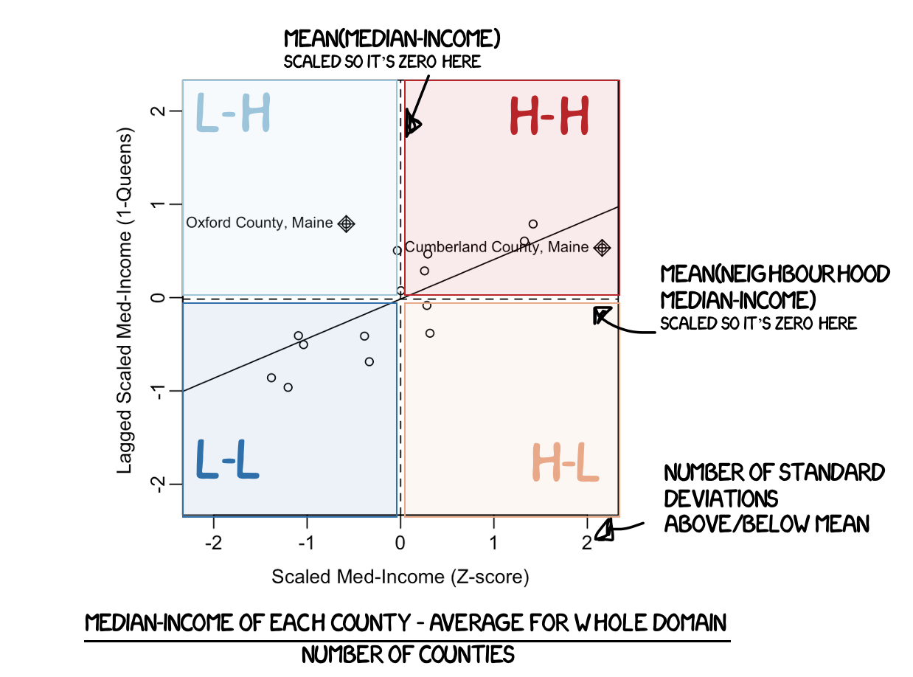
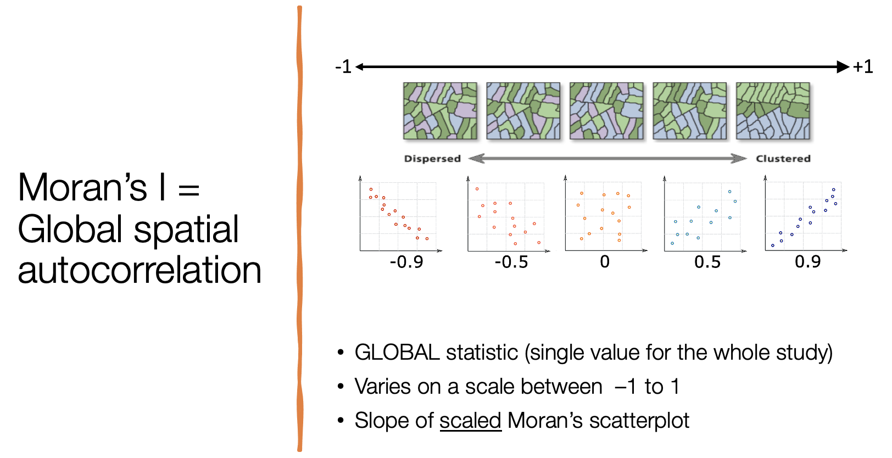

```{r setup, include=FALSE}
## Global options
knitr::opts_chunk$set(cache = TRUE,message=FALSE, warning=FALSE)
```

# Dr G's Autocorrelation Tutorial {#T15_Autocorrelation}

## Background

Broadband access is an important part of accessing resources in today's society. From free educational materials, to the ability to know when a hurricane is coming, the ability to use and access high speed internet Florida is especially interesting because mix of rich/poor areas, different political leanings, along with resident and tourist areas.

### Study parameters

The data was collected from the American Community Survey, taken in 2024.

- **OBJECT OF ANALYSIS:** Per County (variables are per HH in each county)
- **Data-set population:** All the counties in Maine in the 2024 American community survey
- **Study population:** Rural northern New England states in the USA from 2019 to the present day (2026).
- **Mark/Variable**: Median household income [in US dollars per county]

Comparing the dataset and study populations we see that our data is a sample of the study population. It is not randomly sampled out of all years and locations. Although we hope its representative of the study population, there are potentially some issues.

- The data was collected in a single year in 2024

- Equally, we assume that the county statistics are averaged across all people in each county, but we know that the American Community Survey is also biased to miss out undocumented and other vulnerable populations, which are likely to have lower incomes.

## Study aim

The aim of this Lab is to examine the spatial autocorrelation of household income counties in Maine, based on analysis of this dataset and more general research on broadband access.

First we will assess the autocorrelation descriptively, attempting to answer questions such as: Is it clustered/chess-board like? Is there 1st order autocorrelation/2nd order? What are the potential patterns and processes underlying them? We will then use LISA to look at local patterns.

<br>

### Initial data processing

```{r}
# LIBRARIES
library(tidyverse)
library(dplyr)
library(ggpubr)
library(skimr)
library(ggplot2)
library(plotly)
library(knitr)
library(raster)
library(sp)
library(sf)
library(tmap)
library(terra)
library(biscale)
library(tidycensus)
library(cowplot)
library(units)
library(spdep)
library(sfdep)
library(tigris)
```

First, we need to read in the data. You are given yours, but this how to get it from the US Census.

```{r, results="hide"}
# I use results="hide" in the code chunk options to get rid of the output
# View this full screen to see the layout of the command more easily
# THIS WHOLE THING IS ONE BIG COMMAND!
rm(list=ls())
ACS_county.sf <- get_acs(geography = "county",
                         year = 2020,
                         variables = c(population_total   = "B05012_001",  # total population
                                       house_total        = "B25001_001",  # no. houses
                                       income_median      = "B19013_001",  # median income
                                       broadband_total    = "B28002_004"), # broadband
                         state = c("ME"),
                         survey = "acs5",geometry=TRUE,
                         output = "wide",show_call=FALSE) %>%
   dplyr::select(
      GEOID,
      county_name = NAME,
      population_total = population_totalE,
      house_total      = house_totalE,
      income_median    = income_medianE,
      broadband_total  = broadband_totalE)

names(ACS_county.sf)
```

Now we need to do important data processing. this includes: - Changing the map projection - Calculating any "density/rate" columns.\
- Removing any missing counties or census tracts (or the code breaks!)

```{r}
#----- Change the map projection to UTM Maine 
# (I googled the EPSG code)
ACS_county.sf <- st_transform(ACS_county.sf,6348)


#----- Make sure we're looking at population/broadband density
# Get the areas of each county
ACS_county.sf$county_area <- st_area(ACS_county.sf)

# Change the units of the areas from m2 to km2 and overwrite
ACS_county.sf$county_area <- set_units(ACS_county.sf$county_area,"km^2")

# and divide the total population by the area, save as new column
ACS_county.sf$population_density <-ACS_county.sf$population_total /  ACS_county.sf$county_area

# and divide the total broadband by the number of houses, save as new column
ACS_county.sf$broadband_percentage <-ACS_county.sf$broadband_total /  ACS_county.sf$house_total


#----- FINALY..(important!)
# look for empty counties (lakes etc) and remove
tracts_empty <- st_is_empty(ACS_county.sf)
ACS_county.sf <- ACS_county.sf[which(tracts_empty==FALSE), ]
```

<br>

### Looking for skewed data

Population density, wealth and housing density are often very skewed, making it hard to see the spatial patterns and process. For example, imagine if Bill Gates lived in one of your counties; all the statistics would be skewed towards that one person. Moran's I and LISA are inappropriate for skewed data.

To get around this and to see more detail outside cities, we can take the log of any skewed column and save as a new column. For example, from the histogram below, I saw that the population density was highly skewed and so took the log.

```{r}
ACS_county.sf$population_density_log   <- log(ACS_county.sf$population_density)
```

Comparing histograms:

```{r}
par(mfrow=c(1,2))
hist(ACS_county.sf$population_density,
     main=list("Population Density",cex=.7),
     xlab="Population Density")

hist(ACS_county.sf$population_density_log,
     main=list("Log Population Density per Km^2",cex=.7),
     xlab="Population Density")
```

```{r}
map1 <- qtm(ACS_county.sf,fill="population_density",fill.scale=tm_scale(values="brewer.greens"))
map2 <- qtm(ACS_county.sf,fill="population_density_log",fill.scale=tm_scale(values="brewer.greens"))
tmap_arrange(map1,map2)

```

Hopefully it's clear that removing the skew means that you get a clearer view of the spatial patterns. The log patterns are actually intuitive in their own right. E.g. 7 or 8 is a dense city, 0 or 1 is the countryside. Note, when you do this yourself, you might find that even doing this doesn't fix the skew totally, but its not the end of the world if so.

##### Check for Broadband

Let's do the same for our broadband access. We can see that the original isn't very skewed, so we can probably just stick to using the broadband_percentage column and remove this code (unless you wanted, like me, to show that it wasn't skewed)

```{r}
ACS_county.sf$broadband_percentage_log <- log(ACS_county.sf$broadband_percentage)
```

Comparing histograms:

```{r}
par(mfrow=c(1,2))
hist(ACS_county.sf$broadband_percentage,
     main=list("Percent houses with broadband",cex=.7),
     xlab="% Broadband")

hist(ACS_county.sf$broadband_percentage_log,
     main=list("Log Percent houses with broadband",cex=.7),
     xlab="Log % Broadband")
```

As you see, you don't really see any shift in pattern or new understanding.

```{r}

map1 <- qtm(ACS_county.sf,fill="broadband_percentage",fill.scale=tm_scale(values="brewer.blues"))
map2 <- qtm(ACS_county.sf,fill="broadband_percentage_log",fill.scale=tm_scale(values="brewer.blues"))
tmap_arrange(map1,map2)

```

<br>

## Exploratory data analysis

```{r}
tmap_mode("view")

qtm(ACS_county.sf, "income_median",
                    fill.alpha = .5,
                    fill.scale  = tm_scale_intervals(values = "brewer.yl_gn_bu"),
                    fill.legend = tm_legend(title = "Median Income (USD)", 
                                            position = tm_pos_out("right", "center"), 
                                            frame = FALSE))

```

I wanted to show you how I make some quick plots here.

```{r}
# make tmap v4 look like the old tmap v3 maps
tmap_style("v3")

# instead of plotting immediately wait until the end then map together,

# Population density. legend outside on the right, with no box around it
map_totalpop <- qtm(ACS_county.sf, "population_total",
                    fill.scale  = tm_scale_intervals(values = "brewer.yl_gn_bu"),
                    fill.legend = tm_legend(title = "Population", 
                                            position = tm_pos_out("right", "center"), 
                                            frame = FALSE))

## Broadband access
map_broadband <- qtm(ACS_county.sf, "broadband_percentage",
                    fill.scale  = tm_scale_intervals(values = "brewer.yl_or_br"),
                    fill.legend = tm_legend(title = "Broadband (%)", 
                                            position = tm_pos_out("right", "center"), 
                                            frame = FALSE))
                    
# Population density (log)
map_logpopdens <- qtm(ACS_county.sf, "population_density_log",
                    fill.scale  = tm_scale_intervals(values = "brewer.greens"),
                    fill.legend = tm_legend(title = "Log Pop Density", 
                                            position = tm_pos_out("right", "center"), 
                                            frame = FALSE))
                    
# Median income
map_income <- qtm(ACS_county.sf, "income_median",
                    fill.scale  = tm_scale_intervals(values = "brewer.purples"),
                    fill.legend = tm_legend(title = "Median Income", 
                                            position = tm_pos_out("right", "center"), 
                                            frame = FALSE))
                  

tmap_mode("plot")
suppressWarnings(tmap_arrange(map_totalpop, map_broadband, map_logpopdens, map_income, ncol = 2))

# turn the v3 style back off (it was set at the top for this style)
tmap_style("white")

```

We can see clear clusters around the coast and major cities. They tend to be richer and have a higher population density. There is an interesting rural county right in the centre. I would write more about this in my actual report.

<br>

## Spatial Weights Matrix {#T15_Spatialweights}

Here I am going to assume that neighbouring counties are TOUCHING (even at just a corner), so I will use a Queens 1st order neighbourhood matrix. We then make a weights matrix where we average all the weights to sum to 1. 


```{r}

# calculate the spatial neighbourhoods
matrix.queen.county <- st_contiguity(ACS_county.sf, queen=T)


# and plot - they look interlinked!
plot(st_geometry(ACS_county.sf), border = 'grey')
plot(matrix.queen.county, st_geometry(ACS_county.sf), col = 'black', lwd = 1, cex = .2, add = TRUE)

# calculate the standardised spatial weights
weights.queen.county <- st_weights(matrix.queen.county, style='W', allow_zero = T)


```


<br>


## Moran's scatterplot {#T15_Moran}

We now want to see how the median income in each county compares to its neighbours (queens 1st order). We can now calculate and plot this.

To run, copy the whole code chunk into your code, but ONLY EDIT THE TOP PART FOR YOUR OWN DATA.

```{r}

# Edit each row (on the right of the arrows) to match your data/variable names, 
# then run the whole code chunk
myvariable     <- ACS_county.sf$income_median
spatialweights <- matrix.queen.county
pointlabels    <- ACS_county.sf$county_name
title_xaxis    <- "Median Income (USD)"
title_yaxis    <- "Lagged Median Income (USD) (1st order queens) "


# This plots your variable, don't edit below here!
moran.plot(x = myvariable,
           listw  = spdep::nb2listw(spatialweights, style='W', zero.policy=T),
           labels = pointlabels,
           xlab   = list(title_xaxis,cex=.9),
           ylab   = list(title_yaxis,cex=.9),
           cex=.8, cex.axis=.9,
           zero.policy = T)


```

In this case, the mean of x and the mean of y are shown as dotted lines. So we can see which counties have incomes above/below the mean.

As variables are often skewed (even after looking at the log) it's useful to look at the SCALED version of this plot - e.g. how many standard deviations each county's median income is above or below the mean.

There is no simple piece of code to do this, so I have set up the code chunk below where you can simply add your variables as before and then just run the whole code chunk to make the plot.

```{r}

# Edit as before, the only change is adding extra code to my variable.
# then run the whole code chunk

myvariable     <- ACS_county.sf$income_median
spatialweights <- matrix.queen.county
pointlabels    <- ACS_county.sf$county_name
title_xaxis    <- "Scaled Med-Income (Z-score)"
title_yaxis    <- "Lagged Scaled Med-Income (1order-Queens) "


#---This plots your variable, don't edit below here! Just run it!
#   (Those who are good at coding, see if you can work out what I did)

# Scale variables and set plotting params
myvariable.scaled <- as.numeric(scale(myvariable))
spatialweights.sp <- spdep::nb2listw(spatialweights, style='W', zero.policy=T)
wx                <- spdep::lag.listw(spatialweights.sp, myvariable.scaled)
axislims          <- max(abs(c(myvariable.scaled, wx))) * c(-1, 1)
oldpar            <- par(no.readonly = TRUE)
par(pty = "s", mar = c(4, 3, 1, 1), mgp = c(1.8, 0.5, 0))

# plot, then put parameters back to normal. See ?par for new options
moran.plot(x = myvariable.scaled,
           listw  = spatialweights.sp,
           labels = pointlabels,
           xlab   = list(title_xaxis,cex=.9),
           ylab   = list(title_yaxis,cex=.9),
           zero.policy = T,
           asp = 1, 
           xlim = axislims, ylim = axislims,
           cex=.8, cex.axis=.9)

par(oldpar)


```

Here's how to interpret it

```{r}
#| label: fig_scaledmoranI
#| fig-cap: "A scaled moran's scatterplot with the four quadrants colored in."
#| fig-align: "center"
#| echo: false
#| out-width: "500px"


```

**To interpret: we can first use the plot to see which quadrant an individual county falls into:**

- **H-H (top right): Hotspots:**
  - *"high surrounded by high"*:
  - Counties with higher than average variables, surrounded by neighbours that are ALSO higher than average.
  - For us this is a rich area in Maine, e.g. rich counties clustered together <br><br>
- **L-L (bottom left) : Coldspots:**
  - *"low surrounded by low"*
  - Counties with [lower]{.underline} than average variables, surrounded by neighbours that are ALSO [lower]{.underline} than average.
  - For us this is a poor area in Maine, e.g. poor counties clustered together. <br><br>
- **H-L (bottom right): 'Hot outliers':**
  - *"High surrounded by low"*
  - Counties with higher than average variables, but surrounded by neighbours that are [lower]{.underline} than average.
  - For us this might be something like a rich city, surrounded by poor countryside <br><br>
- **L-L (top left) 'Cold outliers':**
  - *"Low surrounded by high"*:
  - Counties with [lower]{.underline} than average variables, but surrounded by neighbours that are higher than average.
  - For us this might be something like an underfunded poor county, surrounded by richer neighbours <br><br>

So if a county, like Cumberland County, falls into the H-H section, "High surrounded by High" then the median-income for that county is higher than average (we can see over 2 standard deviations higher than average), AND the median-income of its neighbours is also higher than average (just). It's a rich county in a rich region.

<br>

### Global Moran's I

Global Moran's I looks at the overall plot to see if the data is generally clustered into hot and cold spots, or if it's more like a chessboard with lots of hot/cold outliers.

```{r}
#| label: fig_moranoverview
#| fig-cap: "A scaled moran's scatterplot with the four quadrants colored in."
#| fig-align: "center"
#| echo: false
#| out-width: "500px"


```

Its very easy to calculate for our data, as we're simply calculating the SLOPE of this:

```{r, echo=FALSE}
# Scale variables and set plotting params
myvariable.scaled <- as.numeric(scale(myvariable))
spatialweights.sp <- spdep::nb2listw(spatialweights, style='W', zero.policy=T)
wx                <- spdep::lag.listw(spatialweights.sp, myvariable.scaled)
axislims          <- max(abs(c(myvariable.scaled, wx))) * c(-1, 1)
oldpar            <- par(no.readonly = TRUE)
par(pty = "s", mar = c(4, 3, 1, 1), mgp = c(1.8, 0.5, 0))

# plot, then put parameters back to normal. See ?par for new options
moran.plot(x = myvariable.scaled,
           listw  = spatialweights.sp,
           labels = pointlabels,
           xlab   = list(title_xaxis,cex=.9),
           ylab   = list(title_yaxis,cex=.9),
           zero.policy = T,
           asp = 1, 
           xlim = axislims, ylim = axislims,
           cex=.8, cex.axis=.9)

par(oldpar)

```

We do this with the `global.moran()` command. I got these variables from the spatial weights matrix section. The `$I` at the end simply means choose the Moran's I statistic only.

```{r}
global_moran(x=ACS_county.sf$income_median,
             nb=matrix.queen.county,
             wt=weights.queen.county)$I
```

So we can see that we have a positive slope, so referring to the diagram above (\\\@ref(fig_moranoverview)), this suggests some clustering.

<br>

### Global Moran's I Hypothesis test

Great! But how do we know that this is 'significant' vs us simply seeing a random pattern and thinking that there is some process causing clustering. To put it another way, we know Independent Random Processes (IRPS) sometimes cause patterns that look clustered or chess-board like simply by chance (even if on average they tend to have I=0), so how can we be sure that our pattern isn't simply one of those.

We can answer this using a HYPOTHESIS TEST.

- This calculates the likelihood that we would see a value of I=0.42 if an Independent Random Process really did cause the pattern.

- So if there is a low likelihood, then we can say that our pattern is unusual compared to one that we would expect from a randomly generated pattern, which suggests that there really is autocorrelation and some spatial process going on,

In this case let's test if our pattern is MORE CLUSTERED than we would expect.

- **H0, I=0 : I hypothesise that an IRP caused this pattern.**
  - *If this was true the average Moran's I would around I=0*
- **H1, I\>0 : The data appears to be MORE clustered than expected from a pattern caused by an IRP.**
  - *So Moran's I would be greater than 0, with a low likelihood of seeing this from an IRP.*

```{r}

# back to normal weights
global_moran_test(ACS_county.sf$income_median,
                  matrix.queen.county, 
                  weights.queen.county,
                  zero.policy = T)

```

We see that:

1.  The expected Moran's I from an IRP would be
    - *Expectation = -0.06666667 (Close to zero, see lecture for why its not exact)*
2.  The actual Moran's I from our dataset is
    - *Moran's I = 0.4244131.*
3.  The p-value shows the probability/likelihood of seeing a Moran's I value as high as 0.317 if H0 really was true.
    - *p-value = 0.0006576 (0.06%)*

**Hyp-test result :**

So there's less than a 0.06% chance of seeing a Moran's I value as clustered as 0.37 if it was caused by an independent random process. Pretty low! Strong evidence to suggest that the data really is clustered..

Whether this is "significant" or not depends on whether you are willing to take the risk that 0.06% of the time this pattern might actually be complete spatial randomness.

<br>

**Effect vs significance:**

Importantly, here we see the two components of a test.

- [The EFFECT SIZE: how clustered/uniform is it.]{.underline}
  - The Moran's I Value. 0.42 isn't perfectly clustered..
- [The SIGNIFICANCE: how likely is it to have seen the result if I repeated it and H0 was true.]{.underline}
  - p=0.00066, pretty unusual.

For example, if I take a single hair from my head, I will "significantly" lose weight (e.g. if I repeated this a thousand times, I'm not likely to put weight on!), But... the effect size itself is meaningless.. (we don't care about losing a microgram). Very significant but small effect.

<br>

**Overall interpretation include both :**

Median-Income shows moderate clustering (I=0.42). It is unlikely that this level of clustering was caused by a random independent process (p=0.00066), suggesting that a county’s median-income is genuinely linked to the incomes of the counties around it.

*(This could be a first-order effect, where an underlying driver of income (such as urbanisation, or the main industries) itself varies smoothly across space. It could also be a second-order effect, where neighbouring counties influence each other through shared labour markets, commuting, or people with similar incomes moving to similar areas. Moran's I can't tell the difference)*

<br>

## LISA (local Moran's I)

Moran’s I is just a global statistic, so it would be useful to know WHERE the data is clustered or not and if that clustering is significant.

**LISA essentially colors the map depending on which quadrant each county was found in.**

### Calculating the LISA statistic

We do this by calculating moran’s I but for each little area, e.g we calculate Moran’s I for each polygon with its neighbours, or see which quadrant each point falls into.

```{r}
LocalMoran <- local_moran(ACS_county.sf$income_median, 
                          matrix.queen.county, 
                          weights.queen.county,
                          alternative = "two.sided")

head(LocalMoran)

```

Here's what the results mean. They calculate significance based on the monte carlo approach we discussed in class:

- `ii` Local moran statistic e.g. Moran's I for each census tract (i)
- `eii` Expected value of local moran statistic;
- `var_ii` variance of local moran statistic;
- `z_ii` Z score of the local moran statistic;
- `p_ii` p-value of local moran statistic for that census tract
- `p_ii_sim` Sim p-value using our Monte Carlo approach for H1 alternative="two.sided"
- `p_folded_sim` The simulation folded [0, 0.5] range ranked p-value (based on <https://github.com/pysal/esda/blob/4a63e0b5df1e754b17b5f1205b8cadcbecc5e061/esda/crand.py#L211-L213>)
- `skewness` the output of e1071::skewness()
- `kurtosis` the output of e1071::kurtosis()
- `mean` the average quadrant of the moran's scattrplot for each census tract (out of the monte carlo)
- `median` the median quadrant of the moran's scattrplot for each census tract (out of the monte carlo)
- `pysal` the pysal average quadrant of the moran's scattrplot for each census tract (out of the monte carlo)

<br><br>

We can simplify this given that we're in an undergrad class! We can also add it to our census data:

```{r}

ACS_county.sf$LocalMoranIncome            <- LocalMoran$ii
ACS_county.sf$LocalMoranIncome_pvalue     <- LocalMoran$p_folded_sim
ACS_county.sf$LocalMoranIncome_Quadrant   <- factor(LocalMoran$pysal,
                                                 levels= c("High-High","High-Low",
                                                           "Low-High","Low-Low"))
 
head(ACS_county.sf)


```

We can now see how many points fell into each quadrant

```{r}
table(ACS_county.sf$LocalMoranIncome_Quadrant)
```

So most of our points fall into hot/cold spots with a reasonable number of outliers

<br><br>

### Plotting LISA results

We can now make our first LISA map!

```{r}
#---------------------------------------------------
# And make a map, remember you can switch to "plot" mode
# if your computer struggles
#---------------------------------------------------
tmap_mode("plot")

mapLISA <-    tm_basemap()+

   tm_shape(ACS_county.sf) +
 
           tm_polygons(
               fill = "LocalMoranIncome_Quadrant",
               fill_alpha = 0.6,
               lwd = 0,
               id = "county_name",
               col_alpha = 0.5,
               fill.scale = tm_scale_categorical(
                                       values = c("#ca0020",
                                                  "#f4a582",
                                                  "#92c5de",
                                                  "#0571b0"))) +
  tm_legend(text.size = 1) +
  tm_title("LISA: Median Income (USD)") +
  tm_layout(frame = FALSE)

# Compare against the original data
maporiginal <- 
   tm_basemap()+
   tm_shape(ACS_county.sf, unit = "km") +
  tm_polygons(
    fill = "income_median",
    lwd = 0,
    fill.scale = tm_scale_intervals(
      style = "quantile",
      values = "brewer.yl_gn_bu",
    )
  ) +
  tm_scalebar(breaks = c(0, 10, 20)) +
  tm_title("Median Income", size = 0.75) +
  tm_layout(
    legend.outside = TRUE,
    frame = FALSE
  )

tmap_arrange(maporiginal,mapLISA)


```

This shows that there tend to be rich hotspots near the coast and poorer hotspots to the north, with some spatial outliers (the high-low one is the tourist district!). BUT.. maybe some parts of this pattern are simple random chance. Lets check.


### Calculate local significance

The Local Moran's I code also calculates the likelihood of seeing this value of Moran's I if an IRP caused the pattern. Because there is much less data, this isn't perfect, but it gives a sense of where we are SURE the pattern is real vs places where an IRP might be responsible (e.g. a random pattern that looks clustered).

It does this by running. many small hypothesis tests and coming up with a p-value/likelihood of IRP for each county.

To see this, we can plot the values next to the p-values. This is useful for investigating the data, although isn't as good for communicating results to a non expert. Because we don't want to suggest that an area where it's likely that the pattern was caused by random chance is actually clustered/gridlike!

```{r}
#---------------------------------------------------
# And make a map
#---------------------------------------------------
tmap_mode("plot")

# Compare against the p values
mapPvalues <- 
   tm_basemap()+
   tm_shape(ACS_county.sf, unit = "km") +
   tm_polygons(
    fill = "LocalMoranIncome_pvalue",
    lwd = 0,
    fill.scale = tm_scale_intervals(
      breaks=c(0,0.001,0.01,0.05,0.1,1),
      values = rev(cols4all::c4a("brewer.greens")))) +
  tm_title("P-value for each quadrant", size = 0.75) +
  tm_layout(
    legend.outside = TRUE,
    frame = FALSE
  )

# I got the mapLISA from the previous code chunk
suppressMessages(tmap_arrange(mapLISA,mapPvalues))

```

This shows that there tend to be rich hotspots near the coast and poorer hotspots to the north, with some spatial outliers (the high-low one is the tourist district!).

We can also see that it's possible our rich hotspots are simply spatial randomness (at least a 10% chance of this as the color scale is \> 0.1)

The likely reason most of our results aren't significant is that we only have 16 counties and many only have one or two neighbours. LISA is normally done on much larger datasets (or it should be!)

<br>

### Putting them together.

For public facing output, we can set the values above some p-value threshold to white. I chose a threshold significance of 0.05. So the colors only plot if there is less than a 5% chance that an independent random process caused this pattern.

```{r}
# get the new values. TRUE if p < 0,05

ACS_county.sf <- ACS_county.sf %>%
  mutate(
    p.LT.05 = LocalMoranIncome_pvalue <= 0.05,
    Quadrant_sig = as.character(LocalMoranIncome_Quadrant),
    Quadrant_sig = if_else(LocalMoranIncome_pvalue > 0.05, 
                       "p>0.05", Quadrant_sig),
    Quadrant_sig = factor(
      Quadrant_sig,
      levels = c("High-High", "High-Low", 
                 "Low-High", "Low-Low", "p>0.05")
    )
  )

# and make a  map


#---------------------------------------------------
tmap_mode("plot")
tm_basemap()+
tm_shape(ACS_county.sf) +
           tm_polygons(
               fill = "Quadrant_sig",
               lwd = 0.5,
               id = "county_name",
               fill_alpha = 0.4,
               fill.scale = tm_scale_categorical(
                                       values = c("#ca0020",
                                                  "#f4a582",
                                                  "#92c5de",
                                                  "#0571b0",
                                                  "white"))) +
  tm_legend(text.size = 1) +
  tm_title("LISA: % earning > $75K if p<0.05") +
  tm_layout(frame = FALSE)


```

So we're pretty certain there is a cold spot in the north. e.g. a poorer part of the state. We were unable to see the patterns in more detail (e.g. most were indistinguishable from those caused by an independent random process), because we only have 16 counties and many only have one or two neighbours. It doesn't mean that an IRP *did* cause our pattern, just that we can't distinguish the difference with this amount of data.

## Conclusion

So.. median income in Maine.

Overall, our data shows moderate clustering (I=0.42). It is unlikely that this level of clustering was caused by a random independent process (p=0.00066), suggesting that a county’s median-income is genuinely linked to the incomes of the counties around it.

To give more detail, it's highly likely there is a cold spot in the north where the median income is lower than expected. We were unable to see local patterns in more detail (e.g. most were indistinguishable from those caused by an independent random process), because we only have 16 counties and many only have one or two neighbours. It doesn't mean that an IRP *did* cause our pattern, just that we can't distinguish the difference with this amount of data.

*Note, I didn't talk about the hotspot or tourist area because it might have been caused by an IRP...*


## Putting all the code together {#T15_AutocorrelationCode}

Here's all the code to make life easier. 

The easiest way to update this is to use ctrl-F, or go to the very top of the entire screen and go to edit/Find-Replace, and then replace ACS_county.sf with your variable name e.g.ChicagoTracts_2010 and income_median with your variable name e.g. tree_cover (or whatever your columns are called..

You will also have to change axis labels (look for the text in quote marks)

```{r, eval=FALSE}

#-----------------------------------------
# SPATIAL WEIGHTS
#-----------------------------------------
# calculate the spatial neighbourhoods
matrix.queen.county <- st_contiguity(ACS_county.sf, queen=T)


# and plot - they look interlinked!
plot(st_geometry(ACS_county.sf), border = 'grey')
plot(matrix.queen.county, st_geometry(ACS_county.sf), col = 'black', lwd = 1, cex = .2, add = TRUE)

# calculate the standardised spatial weights
weights.queen.county <- st_weights(matrix.queen.county, style='B', allow_zero = T)

#-----------------------------------------
# MORANS SCATTERPLOT
#-----------------------------------------
myvariable     <- ACS_county.sf$income_median
spatialweights <- matrix.queen.county
pointlabels    <- ACS_county.sf$county_name
title_xaxis    <- "Median Income (USD)"
title_yaxis    <- "Lagged Median Income (USD) (1st order queens) "


# This plots your variable, don't edit below here!
moran.plot(x = myvariable,
           listw  = spdep::nb2listw(spatialweights, style='W', zero.policy=T),
           labels = pointlabels,
           xlab   = list(title_xaxis,cex=.9),
           ylab   = list(title_yaxis,cex=.9),
           cex=.8, cex.axis=.9,
           zero.policy = T)


#-----------------------------------------
# GLOBAL MORANS I
#-----------------------------------------
global_moran(x=ACS_county.sf$income_median,
             nb=matrix.queen.county,
             wt=weights.queen.county)$I

#-----------------------------------------
# LISA
#-----------------------------------------
ACS_county.sf$LocalMoranIncome            <- LocalMoran$ii
ACS_county.sf$LocalMoranIncome_pvalue     <- LocalMoran$p_folded_sim
ACS_county.sf$LocalMoranIncome_Quadrant   <- factor(LocalMoran$pysal,
                                                 levels= c("High-High","High-Low",
                                                           "Low-High","Low-Low"))
 

#-----------------------------------------
# LISA PLOT
#-----------------------------------------
ACS_county.sf <- ACS_county.sf %>%
  mutate(
    p.LT.05 = LocalMoranIncome_pvalue <= 0.05,
    Quadrant_sig = as.character(LocalMoranIncome_Quadrant),
    Quadrant_sig = if_else(LocalMoranIncome_pvalue > 0.05, 
                       "p>0.05", Quadrant_sig),
    Quadrant_sig = factor(
      Quadrant_sig,
      levels = c("High-High", "High-Low", 
                 "Low-High", "Low-Low", "p>0.05")
    )
  )

tmap_mode("plot")
tm_basemap()+
tm_shape(ACS_county.sf) +
           tm_polygons(
               fill = "Quadrant_sig",
               lwd = 0.5,
               id = "county_name",
               fill_alpha = 0.4,
               fill.scale = tm_scale_categorical(
                                       values = c("#ca0020",
                                                  "#f4a582",
                                                  "#92c5de",
                                                  "#0571b0",
                                                  "white"))) +
  tm_legend(text.size = 1) +
  tm_title("LISA: % earning > $75K if p<0.05") +
  tm_layout(frame = FALSE)


```


